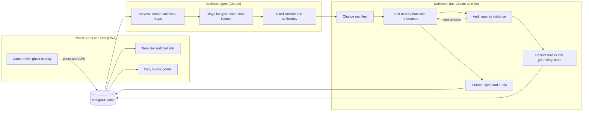

# Chronodex

**Point your phone at a place and collect its past. Every pixel has a receipt.**

> **Replaced for scope by [MASTER.md](MASTER.md) on 14 Nov.** The team has since fixed a different feature set: guide avatars and chat are in, and the build is TypeScript. Keep this file for background only: data sources, the demo route and pitch notes.

Concept and build plan for the Imperial AI Hackathon, 14–15 November 2026. It develops the Chronodex idea in the [README](README.md) and the "Historical PocaDex" note in the IdeaPad into something we can build this weekend and demo on Sunday.

## TL;DR

- **Product.** A mobile web app in three parts. The **Archivist** is an agent that researches the history of any location from real archives. The **Lens** shows that place in earlier eras, lined up with what is in front of your camera. The **Dex** is a collection game: you earn an entry by standing where the old photograph was taken and retaking it.
- **Differentiator.** Several apps already generate an imagined past for any location, and reviewers fault them for inaccuracy. Chronodex reconstructs only from evidence, marks every region of the image as attested or inferred, and links each region to its source. This is the IdeaPad's "no more AI LARP" turned into the core feature.
- **Why it fits this event.** The brief is agentic AI products. The Archivist plans its own research, pulls from many sources, decides whether the evidence is sufficient, commissions reconstructions, audits them, and sends them back when they contradict the record.
- **Demo.** The venue. The Huxley Building stands at 180 Queen's Gate, where a Norman Shaw house stood until about 1971. Three minutes away, the Queen's Tower is the only surviving piece of the Imperial Institute.
- **Do this first.** Saturday's sunset is about 16:10. Someone should photograph the six demo stops before then. Everything else can happen indoors.

## 1. The event

| | |
|---|---|
| Dates | Sat 14 Nov, kickoff 10:00. Sun 15 Nov, demos, finals and prizes, ending about 18:00 |
| Venue | Huxley Building, 180 Queen's Gate, Imperial College London |
| Brief | "Build agentic AI products over a weekend", with sponsor-set tracks and mentors on the floor |
| Partners | Adaption Labs (headline). Anthropic, Figma, Reply (gold). fal, ElevenLabs, Tavily, Linkup, MongoDB, Lovable, Databricks, E2B, Synthesia, Anam, Optiver, Jane Street, tbd.fund, Boltz, Tamarind Bio |
| Not published | Track briefs, judging criteria, submission deadline. Fill these in from the kickoff and adjust section 8 |

## 2. The problem with the obvious version

The README idea, built literally, is "pick a place, pick a year, generate a picture". That product already exists several times over: [TimeMap](https://apps.apple.com/za/app/timemap-ai-time-travel/id6760267871), [Time Boy](https://apps.apple.com/us/app/time-boy-see-the-past/id6758055161), [TimeCam](https://www.timecam.ai/), History Revived and others. They share one weakness. The output is invented. Time Boy's own listing calls it artistic interpretation, and a reviewer of a similar Street View tool found the historical views inaccurate.

A judge who has seen one of these will ask how ours is different. The answer has to be visible in the first 30 seconds of the demo:

1. **It shows its sources.** Tap any part of a reconstruction and see the photograph, map or record behind it, or an honest "inferred" label.
2. **It refuses to guess.** If the archives are thin for an era, it says so and shows the oldest map instead.
3. **You have to go there.** Entries are collected by physically standing at the spot, which the existing apps do not ask of anyone.

## 3. The concept

**Two dials: when, and how sure.** Every place in Chronodex has a time dial and a trust dial. The time dial moves through eras. The trust dial moves from raw archival evidence, to a restored version of it, to a full reconstruction. A user can always drop back to the untouched original.

| README or IdeaPad said | Chronodex does | Reason |
|---|---|---|
| Scrape Google Earth and Maps photos back to the first recorded | Shows Street View's history (2008 onward in London) inside Google's own viewer. Uses open archives and the user's own photo as model input | Google's terms restrict reuse of its imagery, its record starts in 2008, and the interesting history is older |
| Web search historical records | The Archivist agent, with search and archive tools, produces a cited timeline | This is the agentic core |
| Generate or upscale reconstructions | Restore real photos, then reconstruct by editing the user's own photo with archival references attached, then audit | Editing keeps the camera position, so every era lines up |
| 3D or AR/VR overlay through the phone camera | Ghost overlay on the live camera, then a registered time slider on your shot. Live tracking and a 3D "step inside" view are stretch goals | iOS Safari still appears to lack WebXR, and the photo approach works on every phone |
| Routes, points for taking pictures, no AI LARP | The Dex: capture by rephotography, presence-checked, with routes and rarity | Makes it a reason to go outside |

## 4. What a user does

1. Open the app near the Huxley Building. The map shows nearby entries as grey silhouettes.
2. Tap "Imperial Institute, 1893". The camera opens with an 1890s photograph as a translucent ghost. Walk until the tower in the ghost sits on the real Queen's Tower.
3. Take the photo. The app checks that you are there, scores the alignment and awards the entry.
4. Turn the time dial. Your photo dissolves back through the 1960s demolition to the 1893 Institute. Turn the trust dial from archival photo to reconstruction. Switch on Receipts: the image tints green where a source attests it and amber where the model inferred it. Tap the tower to see the source card.
5. Receive a short chrono-lapse of the spot that ends on your own photo, with narration. Your photo joins the place's timeline as its 2026 layer.
6. The route card points to the next stop, 180 m away.

**Scouted versus captured.** Anyone can ask the Archivist to scout any place in the world from their sofa and browse the result. It only counts in the Dex once you have been there. Rarity follows age and loss: common (still standing), rare (pre-1900), epic (heavily altered), legendary (gone entirely).

## 5. How it works

### 5.1 Archivist: research any place

Input is a coordinate and optionally a photo. Output is an evidence pack and a cited timeline.

1. **Resolve.** Find named things within about 150 m from Wikidata and OpenStreetMap.
2. **Fan out.** Query archives and the web in parallel (section 7).
3. **Triage.** A cheap vision model looks at every candidate image. Is it this place? Which way does it face? What year, from metadata first and visual cues second, as a range? Is the licence usable?
4. **Assemble.** Build eras and events (built, altered, bombed, demolished, rebuilt), each with a citation.
5. **Judge sufficiency.** For each era, decide whether there is enough to reconstruct. If not, stop at the map layer and say so.

The run streams a trace to the app ("reading Survey of London vol. 38", "found 14 photographs, 6 usable"). The trace is the visible proof that this is an agent and not a prompt.

### 5.2 Change manifest

Claude compares the user's photo with the evidence for an era and writes a structured list: what persists, what was altered, what did not exist yet, what stood here and is gone. It is a diff for a street corner. It becomes the edit instruction, the basis for the receipts, and a feature in its own right ("What changed since 1893").

### 5.3 Darkroom: reconstruct by editing the user's photo

This is the trick that makes the weekend feasible. We do not generate from text. We edit the user's own photograph with a multi-reference image model, passing the archival photos as references and the change manifest as instructions. The camera position is preserved, so every era is registered to every other era and to the live view with no pose estimation or 3D.

The trust dial has three stops:

- **Evidence.** The archival photograph, untouched, with its source.
- **Restored.** The same photograph cleaned and upscaled, labelled as restored.
- **Reconstructed.** The full view from where you stand, labelled as a reconstruction with a grounding score.

### 5.4 Audit and receipts

1. Claude receives the reconstruction, the evidence pack and the timeline, and returns each major element with a status: attested (visible in a named source), inferred (consistent with the record but not shown), or contradicted.
2. Anything contradicted goes back to the Darkroom with the correction, for up to three rounds.
3. A text-prompted segmentation model turns each element into a mask. The app tints the masks and uses them as tap targets for source cards.
4. Every card carries a grounding score, for example "68% attested, 32% inferred".

The grounding score is also our evaluation. Log it for every seeded place, before and after the critic loop, and put the numbers on a slide.

### 5.5 Capture: proof you were there

- **Presence.** GPS within about 50 m, and the photo must be taken in the app.
- **Alignment.** Start with Claude as referee: show it the user's shot and the archival photo and ask for a same-vantage score. If time allows, add a geometric check with LoFTR or LightGlue and a RANSAC homography, using inlier count as the score.
- **Points.** Rarity multiplied by alignment, with a bonus for the first capture of an entry.

### 5.6 Chrono-lapse

Because every era frame is an edit of the same photo, the frames are a locked-off sequence. Feed consecutive pairs to a first-and-last-frame video model, join the clips with ffmpeg, and add narration and a period soundscape. This is the clip people share and the closing beat of the demo.

### 5.7 Stretch: step inside

Send a reconstruction to a world model that returns a Gaussian splat, and render it in the browser with device-orientation controls so the phone becomes a window into the era. Build this only after a full rehearsal of everything above has passed.

## 6. Architecture and stack



| Layer | Choice | Notes |
|---|---|---|
| App | Next.js PWA on Vercel, MapLibre for the map, `getUserMedia` and a canvas for the camera and ghost | The camera needs HTTPS. iOS needs a tap before it grants device orientation |
| Worker | Python FastAPI process that picks jobs from a `jobs` collection. The app polls job status | Agent runs take minutes, so keep them out of request handlers |
| Agent | `claude-opus-5-5` as orchestrator with the SDK tool runner. `claude-haiku-5-5` for bulk image triage. Server tools `web_search_20260209` and `web_fetch_20260209`, plus Tavily or Linkup as custom tools | On Opus 5.5, forced `tool_choice` and disabled thinking return a 400. Use structured outputs (`output_config.format`) for JSON |
| Images | fal: `google/nano-banana-2.1/edit` (listed as taking up to 14 reference images) or `fal-ai/nano-banana-2/edit` | Check IDs on the model page before coding against them |
| Masks | fal: `fal-ai/sam-3/image`, which accepts a text prompt | |
| Video | fal: `fal-ai/veo3.1/first-last-frame-to-video`, or the Kling O1 and FLUX.3 equivalents | Use the fast or draft variants while iterating |
| Audio | ElevenLabs text to speech and sound effects | |
| Store | MongoDB Atlas. A 2dsphere index answers "what is near me". A vector index retrieves evidence for a view | Images go in any blob store |
| Stretch 3D | World Labs World API returns `.spz`. Spark (`@sparkjsdev/spark`) renders it in three.js | Generation takes minutes and costs credits |

One entry, as stored (values illustrative):

```json
{
  "place": { "id": "queens-tower", "name": "Queen's Tower",
             "loc": { "type": "Point", "coordinates": [-0.1769, 51.4983] } },
  "era": { "label": "Imperial Institute", "from": 1893, "to": 1957 },
  "rarity": "legendary",
  "evidence": [
    { "id": "ev_014", "kind": "photo", "year_range": [1894, 1898],
      "source_url": "...", "licence": "public domain" }
  ],
  "reconstruction": {
    "image": "recon_v3.png", "base_capture": "cap_88", "rounds": 2,
    "grounding": { "attested": 0.68, "inferred": 0.32 }
  },
  "receipts": [
    { "label": "central tower", "status": "attested",
      "mask": "m_01.png", "evidence_ids": ["ev_014", "ev_021"] }
  ],
  "story": { "text": "...", "citations": ["src_3", "src_7"] },
  "media": { "chronolapse": "lapse.mp4", "narration": "voice.mp3" }
}
```

## 7. Data sources

| Source | Gives us | Access | Terms |
|---|---|---|---|
| Wikimedia Commons | Geotagged photographs, prints and engravings with dates | MediaWiki API geosearch, no key | Per file, mostly public domain or CC. The metadata states the licence |
| Wikidata and Wikipedia | Built and demolished dates, architect, style, heritage status | SPARQL with `wikibase:around`, no key | CC0 and CC BY-SA |
| Survey of London on British History Online | Building-by-building history of South Kensington, with plates | Fetch the pages | Free to read. Cite it, do not republish plates |
| Historic England | Listing records, Bedford Lemere and aerial photographs | Open-data hub for listings | Archive images are their copyright. Link and cite only. An automated fetch of an archive page returned 403 |
| National Library of Scotland maps | Georeferenced Ordnance Survey maps, 1840s to 1960s | XYZ tiles through a MapTiler key | Free for non-commercial use with attribution |
| Mapillary | Street-level photos with timestamp and heading, roughly 2014 onward | Graph API v4, bounding-box query | CC BY-SA 4.0 as far as I know. Confirm |
| Geograph, Europeana, Flickr Commons | More dated, located photographs | Free API keys | Per item |
| Tavily or Linkup | Local history pages, archive catalogues, news | Sponsor APIs | |
| Google Street View | Panoramas from 2008 to now | Maps JavaScript API. `StreetViewService.getPanorama()` returns an undocumented `time` list of earlier panoramas | Display in Google's viewer only. Never model input. The field is undocumented and may break |
| The user's own photos | The present, growing into a record | In-app capture | Blur faces and number plates before adding to a shared timeline |

## 8. Sponsor fit

Use a sponsor's product where it does real work. Do not bolt things on.

| Partner | Role in Chronodex |
|---|---|
| Anthropic | The Archivist agent, image triage and dating, the change manifest, the audit, the capture referee |
| fal | Every generated pixel: restoration, reconstruction, masks, chrono-lapse |
| Tavily, Linkup | The agent's search tools. Pick one as primary, or use both if both offer prizes |
| MongoDB | Geospatial queries, vector retrieval, the job queue, the Dex itself |
| ElevenLabs | Narration and period soundscapes |
| Lovable, Figma | Scaffold and design the app screens quickly |
| Adaption Labs | Stretch only. Their AutoScientist trains a model from data. A small photo-dating model trained on dated Commons photos would fit, if their track rewards it |
| E2B | Optional sandbox if the agent needs to run ffmpeg or image alignment code |
| Synthesia, Anam | Skip. A talking historical avatar is the AI LARP we are avoiding |

## 9. The demo

### Seeded route: Albertopolis, six stops, a loop of roughly 1.5 km

| Stop | What was there | Why it demos well |
|---|---|---|
| Huxley Building, 180 Queen's Gate | Norman Shaw's No. 180, built 1883–85, demolished about 1971 | It is the venue. Photographs from 1956 and 1961 are in the Survey of London |
| Queen's Tower | The Imperial Institute by T. E. Collcutt, 1887–93, demolished 1957–67 except the tower | The tower is in every old photograph, so it is the easiest alignment target |
| Royal Albert Hall | Opened 1871 on land bought with the Great Exhibition's surplus | Still standing. Shows the common tier and tight alignment scoring |
| Exhibition Road | Rebuilt as a shared space in 2010–11 | Recent history from real Street View imagery, with no generation |
| V&A, Exhibition Road side | Blitz shrapnel scars left as a memorial. New entrance and courtyard opened 2017 | The evidence is visible in the stone today |
| Natural History Museum | Opened 1881 on the site of the 1862 International Exhibition building, demolished 1864 | A lost predecessor with engravings and early photographs |

Stop 1 is checked against the Survey of London. The other dates are from general knowledge. Let the Archivist confirm and cite them before they appear on a slide.

### Three-minute script

| Time | Beat |
|---|---|
| 0:00 | "This room is built on a demolished Norman Shaw house." Mirror the phone. Huxley entrance, dial back to the real 1961 photograph, then the 1890 reconstruction. Switch on Receipts, tap a region, show its source |
| 0:40 | Ask a judge to name any place. Start a live Archivist run and leave the trace on screen |
| 0:50 | The Dex: map, six entries, rarity, Saturday's capture with its alignment score, the route |
| 1:30 | One slide: evidence pack, change manifest, edit, audit, receipts. One number: grounding score before and after the critic loop |
| 2:10 | Chrono-lapse of the Queen's Tower with sound |
| 2:35 | Return to the live run. Either a new entry or an honest "not enough evidence before 1900, here is the 1890s map" |
| 2:50 | "Every other AI time machine makes things up. Chronodex shows its receipts, and makes you go outside." |

Record a backup video of the whole flow on location. Venue Wi-Fi and phone mirroring fail at the worst moment.

## 10. Build plan

### Scope

**Must have**
1. One place end to end from hand-picked evidence: reconstruction, time dial, trust dial.
2. Receipts overlay with tappable sources and a grounding score.
3. Ghost-overlay capture with a presence check and a score.
4. Dex grid and map with the six seeded places.
5. An Archivist run on an arbitrary place with a live trace. It may be slow and it may return "not enough evidence".

**Should have**
6. Critic loop that regenerates on contradiction.
7. Chrono-lapse, narration and soundscape.
8. Routes: one curated, one generated by the agent.

**Stretch, only after a full rehearsal passes**
9. Live overlay held in place with the gyroscope.
10. Splat "step inside" view.
11. Photo-dating model via Adaption.
12. Leaderboard and sharing.

### Timeline

Times assume a Sunday midday submission. Confirm the real deadline and shift accordingly.

| When | Goal |
|---|---|
| Sat, before 16:00 | Field: shoot all six stops, landscape, straight on, from several distances. Indoors: repo scaffold, API keys and credits, Mongo schema, a hand-made evidence pack for the Queen's Tower, one reconstruction from a single fal call |
| Sat 16:00–20:00 | Vertical slice for one place: evidence, reconstruction, time dial, on a real phone over HTTPS |
| Sat 20:00–00:00 | Archivist automated. Audit and receipts. Capture flow and score. Dex grid and map |
| Sun 00:00–03:00 | Run the other five stops. Critic loop. Chrono-lapse and audio. Sleep in shifts |
| Sun 07:30–09:00 | Daylight returns about 07:20. Record the backup video. Reshoot weak captures |
| Sun 09:00 to freeze | Polish, slides, three rehearsals of the live run on unseen places. Freeze features two hours before submission |

### Four workstreams

- **A. Archivist.** Agent loop, source tools, evidence and timeline schema, sufficiency decision, trace events.
- **B. Darkroom.** fal calls, change manifest to edit prompt, audit, masks, critic loop, chrono-lapse, audio.
- **C. App.** PWA shell, map, camera and ghost overlay, the two dials, receipt tap targets, Dex, routes.
- **D. Field and demo.** Photography, seed evidence curation, capture referee endpoint, grounding numbers, slides, backup video, track submissions.

## 11. Risks

| Risk | Mitigation |
|---|---|
| A judge picks a place with thin archives | The honest "not enough evidence" result is a feature. Rehearse it. Seeded places carry the demo |
| A reconstruction contradicts the record | Critic loop, visible labels, grounding score. Never present a reconstruction as a photograph |
| Generation is slow | Precompute and cache every seeded place. The live run is a side show with a trace |
| Network or mirroring fails | Backup video, phone hotspot, screenshots in the slides |
| Licensing questions | Open sources and the user's own photos as model input. Street View only in Google's viewer. Attribution on every card |
| Scope creep into AR and 3D | Stretch items are locked until a full rehearsal passes |
| GPS drifts between tall buildings | Generous geofence. The visual match is the real proof |
| Sensitive history | No identifiable real people in reconstructions. For sites of atrocity, text and original evidence only |

## 12. Pitch notes

**One line.** Chronodex is a time machine for real places that shows its sources and makes you go outside.

**Why now.** Image-editing models that accept many reference images and hold the camera position, vision models cheap enough to triage hundreds of archive photos per place, first-and-last-frame video, text-prompted segmentation and agents with web search all became practical within the last year or so.

**Who it is for.** Tourism boards, museums and heritage bodies that want trails through their own collections. Schools running local history trips. Archives that have digitised images and no audience for them. The side effect is a growing, dated, street-level photographic record made by users.

**Likely questions**

- *How do you know it is accurate?* We often do not, and the product says so. Two dials, receipts on every region, a grounding score, and refusal when evidence is thin.
- *How is this different from TimeMap or Time Boy?* They generate an impression. We generate from evidence with per-region provenance, and entries are earned on location.
- *Is scraping Google allowed?* We do not scrape it. Street View appears in Google's own viewer. Model input is open archives and the user's own photo.
- *What is agentic about it?* Multi-step research across tools, a judgement about evidence sufficiency, self-critique with regeneration, and route planning, all without a human in the loop.
- *Does it work outside London?* The agent is location-agnostic. Coverage follows the archives, and a partner can upload a collection to fill a gap.

## 13. Not yet verified

- Track briefs, judging criteria and the submission deadline. None are published online.
- The exact wording of Google Maps Platform terms on using Street View imagery with AI models. A third-party summary says use in machine learning is barred. The plan avoids the question by not using it as input.
- fal endpoint IDs and reference-image limits. They came from fal's pages via search, and fal's own pages disagree on the limit for Nano Banana Pro.
- Mapillary's licence, and which National Library of Scotland map layers the tile API exposes for London.
- World Labs generation time and cost per world. Only third-party figures were found.
- The demolition year of No. 180 Queen's Gate. The Survey of London records it as demolished with photographs from 1956 and 1961. The 1971 date comes from a Getty record I did not open.
- Whether iOS Safari has gained WebXR. Most sources say no. One says yes.

## Sources

- Event: [Imperial AI Hackathon on Luma](https://luma.com/c6zebxau), [Imperial AI Week](https://luma.com/yslv1j9u), [HackathonRadar listing](https://www.hackathonradar.com/database/hackathon/imperial-ai-hackathon-2026), [HackathonHub listing](https://hackathonhub.eu/events/imperial-ai-hackathon-london-2026)
- Site history: [Survey of London vol. 38, plate 102](https://www.british-history.ac.uk/survey-london/vol38/plate-102), [Historic England, Queen's Gate photograph](https://historicengland.org.uk/images-books/photos/item/BL13479), [Getty record](https://www.getty.edu/cona/CONAFullSubject.aspx?subid=700054340)
- Existing apps: [TimeMap](https://apps.apple.com/za/app/timemap-ai-time-travel/id6760267871), [Time Boy](https://apps.apple.com/us/app/time-boy-see-the-past/id6758055161), [TimeCam](https://www.timecam.ai/), [Revisit](https://revisitvr.com/), [Google Maps Mania on Street View time travel](https://googlemapsmania.blogspot.com/2025/11/time-traveling-with-street-view.html)
- Street View: [image metadata docs](https://developers.google.com/maps/documentation/streetview/metadata), [the undocumented `time` list](https://loichovon.com/posts/streetview-time-travel.html)
- Maps and photos: [NLS historic maps API](https://geo.nls.uk/maps/api/), [MapTiler guide to NLS layers](https://docs.maptiler.com/guides/maps-apis/maps-platform/nls-historical-maps-api-historical-maps-of-great-britain-for-use-in-mashups/), [Mapillary API](https://www.mapillary.com/developer/api-documentation)
- fal: [Nano Banana 2.1](https://fal.ai/nano-banana-2.1), [Nano Banana 2 edit](https://fal.ai/models/fal-ai/nano-banana-2/edit), [Veo 3.1 first and last frame](https://fal.ai/docs/model-api-reference/video-generation-api/veo3.1-first-last-frame-to-video), [SAM 3 image](https://fal.ai/models/fal-ai/sam-3/image), [image to 3D models](https://fal.ai/explore/image-to-3d-model-apis)
- 3D and AR: [Spark renderer](https://sparkjs.dev/docs/overview/), [World Labs API pricing](https://docs.worldlabs.ai/api/pricing), [WebXR browser support](https://threejsresources.com/webxr/browsers)
- Adaption Labs: [company page](https://en.wikipedia.org/wiki/Adaption_(company)), [blog](https://adaptionlabs.ai/blog)
