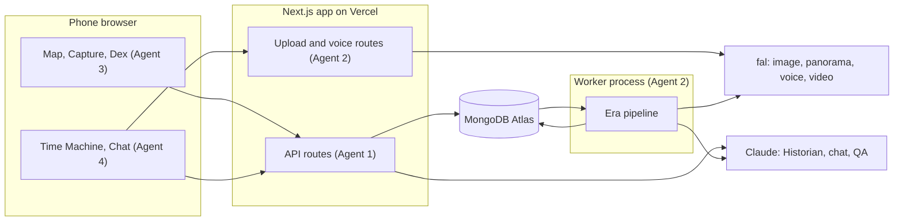

# Chronodex: master context for all agents

**Status:** PLAN v1.1, updated Sat 14 Nov 2026 at 15:30. Waiting for team review. Nothing is built yet.

This file is the single source of truth for the build. If it disagrees with any other file, this file wins. `CHRONODEX.md` is the earlier concept: use it for background (demo route, data sources, pitch notes), not for scope.

**To start an agent, in any tool:** `Read MASTER.md. You are Agent N.`
Claude Code loads this file by itself through `CLAUDE.md`, so `You are Agent N` is enough there.

## Plan at a glance

**What we build.** A mobile website. The main screen is a retro game-style map of landmarks. Stand within 50 m of one, take its picture and you collect its badge. That opens a Time Machine: pick a year, look around a 360° view of the place as it was, and watch a guide from that year walk up, talk for about 45 seconds and walk off. Then text or talk with that guide in a chat styled like text messages.

**Four agents, no shared files.**

| Agent | Name | Owns |
|---|---|---|
| 1 | Core | Project scaffold, shared types, database, API, history research and chat brain (Claude), deploy, integration |
| 2 | Studio | Everything generated with fal: images, 360° panorama, voice, guide video, the worker that runs it |
| 3 | Explorer | App shell, map (main screen), location, camera capture, Dex |
| 4 | Time Machine | Time Machine screen, 360° viewer, guide video player, chat screen, voice in and out |

**How they work together.** Agents talk on `BOARD.md`: every commit adds one post that @-mentions the agents it affects. An agent asks its human before every commit. Each agent may hand mechanical work to a Haiku subagent, within the limits of its sheet in `.claude/skills/haiku-delegate/`.

**Milestones.** Clock times assume agents start at about 15:15 on Saturday and a Sunday-midday submission. If agents start later, move every target by the same amount. The real deadline is not published. Confirm it and adjust.

| | Milestone | Target | Gate |
|---|---|---|---|
| M0 | Foundation | Sat 16:15 | Scaffold on `main`, shared types frozen, every screen renders from mock data |
| M1 | Risky parts proven | Sat 17:45 | Each fal step works once on a real photo. 360° viewer works on a real phone |
| M2 | Vertical slice | Sat 20:00 | One landmark, one year, real data, on a phone: capture, badge, 360°, narration, chat |
| M3 | Full loop | Sat 23:00 | Guide video, live generation with progress, voice chat, Dex, all six landmarks seeded |
| M4 | Content complete | Sun 02:00 | Demo eras pre-generated overnight, media backed up |
| M5 | Demo ready | Sun 10:00 | Polish, rehearsals, backup video. Feature freeze two hours before submission |

**Do first.** Sunset is about 16:10 today. Two people photograph the six landmarks now (section 10, H1). One person gets the keys (H2). Agent 1 starts M0 at once. Agents 2, 3 and 4 start their spikes, which need no scaffold.

## Contents

0. Start here (agents)
1. Product spec
2. Architecture and stack
3. Repo layout and ownership
4. Contracts (frozen at M0)
5. fal plan
6. Google imagery: what is allowed
7. Claude usage
8. Engineering rules: commit approval, documentation standard, dev notebook, agent board, Haiku delegation
9. Roadmap and gates
10. Do first: human tasks
11. Agent briefs
12. Demo content
13. Open questions for the team
14. Verified and not verified
15. Changelog

## 0. Start here (agents)

1. You have been told which agent you are, 1 to 4. If you are asked to build or change code and have not been told, ask. Do not guess.
2. Read sections 1 to 9 of this file, then your brief in section 11.
3. Read `notebook/agent-N.md`. Its "Current state" block says where the last session stopped. Then read the decisions and contract changes in `DEV_NOTEBOOK.md`.
4. Read `BOARD.md` from the last post your notebook says you read. Answer anything addressed to you or to `@all` (section 8.6).
5. Do the first unticked task in your notebook page. Work only in paths you own (section 3). Hand mechanical work to Haiku where your delegation sheet allows it (section 8.7).
6. Before you stop: run `npm run check`, tick the task, add a log entry, rewrite your "Current state" block, write your board post, then **ask your human to approve the commit** (section 8.1). Do not commit without a yes.

You may not edit this file. To change the plan or a contract, post to `@team` on the board and tell your human.

## 1. Product spec

This restates the team's spec (`prompt-record.md`). Where the spec was open to more than one reading, the reading chosen is marked **Assumption** so the team can overrule it.

### 1.1 Screens

| Route | Screen | Owner |
|---|---|---|
| `/` | **Map**, the main screen. Retro game-style map of the city with a marker per landmark. Capture button at the bottom. Main menu | Agent 3 |
| `/capture` | **Capture.** Camera, location check, badge award | Agent 3 |
| `/dex` | **Dex.** Grid of badges, collected and not | Agent 3 |
| `/time/[landmarkId]` | **Time Machine.** Year picker, 360° view, guide video, then/now slider | Agent 4 |
| `/chat/[eraId]` | **Guide chat.** Text-message style, text or voice | Agent 4 |

### 1.2 Flow

The three parts run one after the other. The main menu lets a player jump back to the map, the Dex, or the Time Machine and chat of any landmark already collected.

**Part 1: capture and Dex**

1. The player opens the site and shares location. The map shows the landmarks and the player's position.
2. The player faces a landmark and presses the capture button. The camera opens and they take a picture.
3. If they are within 50 m of a landmark they collect its badge. The badge then shows on the map and in the Dex.
4. If they are too far, the app says how far and in which direction the nearest landmark is.

**Part 2: Time Machine**

5. After collecting, the player lands on the Time Machine for that landmark. It lists a series of eras, each a specific year.
6. For the chosen year the surroundings are loaded if they already exist, otherwise generated. Eras are shared by all players.
7. The 360° view lets the player look around by moving the phone and see the place as it was in that year.
8. A guide video is then generated, or loaded, from the same spot. A guide from that year walks up, introduces themself by name, speaks for about 45 seconds about customs of the time and fun facts in an accent that fits the period, then walks off.
9. A headshot of the guide is generated. It is the profile picture in the chat.

**Part 3: guide chat**

10. The player chats with the guide by text or by voice. The chat looks like a text-message thread.
11. The guide is warm, adds extra fun facts about the area, and suggests other landmarks to visit. Replies can be played aloud in the guide's voice.

### 1.3 Assumptions for the team to confirm

| # | Assumption | Why |
|---|---|---|
| A1 | "Pokémon-style map" means an original retro handheld-RPG look: pixel art, flat colours. No Pokémon or Nintendo names, sprites, fonts, sounds or map layouts | Keeps the app clear of someone else's IP in front of judges |
| A2 | One guide per landmark and year. The chat is with the guide of the year being viewed. Guides are fictional people, never real named individuals | The spec has a guide "from the era" in the video and the same face in the chat |
| A3 | "Within 50 m of a landmark" is measured to the landmark's **photo spot**, the point on the pavement where the reference photo was taken | The centre of a large museum is more than 50 m from any street |
| A4 | Up to 25 m of the phone's reported GPS error is forgiven | GPS is poor between tall buildings |
| A5 | "AR view" means a 360° image moved by the phone's gyroscope. Overlaying the past on the live camera is a stretch goal | Works in every mobile browser. Camera-tracked AR does not |
| A6 | The guide video is three clips played back to back: walk on, talk, walk off | No model makes this in one shot. See section 5 |
| A7 | Every still and video is 16:9 landscape | One aspect ratio keeps every stage aligned, and the demo projector is landscape |
| A8 | Google imagery is never scraped, stored or fed to a model | Section 6 |
| A9 | Generated views carry a small "AI reconstruction" label, and each era lists its sources | Honest, and it answers the judge who asks how we know it is accurate |

### 1.4 Not in scope

Accounts and login. Payments. Native apps. Any landmark outside the seeded list until M4 is done. Multiplayer.

## 2. Architecture and stack



| Layer | Choice | Reason |
|---|---|---|
| Language | TypeScript everywhere | One set of shared types for four agents |
| App | One Next.js app (App Router) at the repo root, React, Tailwind, npm | Front end and API in one deploy |
| Hosting | Vercel | Camera, location and gyroscope all need HTTPS |
| Database | MongoDB Atlas free tier, official `mongodb` driver | Event sponsor. Geo index for "what is near me" |
| Generated media | fal, called from the server and the worker only | Required, and there is a prize for best use |
| Text and reasoning | Claude through the Anthropic API | Event sponsor. Research, persona chat, checking images |
| Long jobs | A Node worker (`npm run worker`) that takes jobs from MongoDB | An era takes minutes. Serverless requests time out |
| Map | MapLibre GL JS with OpenFreeMap tiles (no key) | Free, restylable to a game look |
| 360° view | Photo Sphere Viewer with its gyroscope plugin | Maintained, handles phone orientation |
| Identity | Anonymous `playerId` (UUID) in `localStorage` | No login screen |

The worker runs on a team laptop or a small VM. If it is down, everything already generated still loads. Only new generation stops.

## 3. Repo layout and ownership

One owner per path. You never edit a path you do not own. If you need a change there, ask its owner on the board (section 8.6).

| Path | Owner |
|---|---|
| `MASTER.md`, `CLAUDE.md`, `AGENTS.md` | Humans |
| `.claude/skills/` | Humans |
| `DEV_NOTEBOOK.md` | Agent 1 and humans |
| `notebook/agent-N.md` | Agent N |
| `BOARD.md` | Every agent, by adding lines at the bottom only (section 8.6) |
| `spikes/agent-N/` | Agent N. Throwaway experiments, own `package.json`, never imported by `src/` |
| `package.json`, lockfile, config files, `.env.example`, `README.md` | Agent 1 |
| `src/lib/contracts/` | Agent 1. Frozen at M0 |
| `src/lib/client/` (typed API client, mock mode) | Agent 1 |
| `src/lib/db/`, `src/lib/jobs/`, `src/lib/historian/`, `src/lib/chat/` | Agent 1 |
| `src/app/api/` except the two below | Agent 1 |
| `fixtures/`, `scripts/seed.ts` | Agent 1 |
| `src/lib/fal/`, `src/lib/pipeline/`, `src/worker/` | Agent 2 |
| `src/app/api/uploads/`, `src/app/api/voice/` | Agent 2 |
| `scripts/pregenerate.ts`, `scripts/backup-media.ts` | Agent 2 |
| `src/app/layout.tsx`, `src/app/globals.css`, `src/components/ui/` | Agent 3 |
| `src/app/page.tsx`, `src/app/capture/`, `src/app/dex/`, `src/components/explore/` | Agent 3 |
| `public/sprites/`, `public/manifest.webmanifest`, icons | Agent 3 |
| `src/app/time/`, `src/app/chat/`, `src/components/time-machine/`, `src/components/chat/` | Agent 4 |

**New dependencies.** Agent 1 installs the shared set at M0 (task A1-02). After that, anyone who needs a package adds it in a commit that touches only `package.json` and the lockfile, pulls first, pushes straight away, and notes it in their notebook page. If the lockfile conflicts, take the incoming lockfile, re-add your one line to `package.json`, and run `npm install`.

## 4. Contracts (frozen at M0)

Agent 1 copies these into `src/lib/contracts/types.ts` unchanged, adds matching zod schemas, and exports everything from `src/lib/contracts/index.ts`. After M0 a change needs a `CONTRACT` post on the board, a human yes, and an entry in the contract log in `DEV_NOTEBOOK.md`.

### 4.1 Types

```ts
/** Lowercase kebab-case slug, for example "queens-tower". Never contains "_". */
export type LandmarkId = string;

/** `${landmarkId}_${year}`, for example "queens-tower_1893". Always build it with eraIdOf(). */
export type EraId = string;

/**
 * WGS84 degrees.
 * GeoJSON, MongoDB and MapLibre all use [lng, lat] order. Convert only in src/lib/db and in map code.
 */
export interface LatLng {
  lat: number;
  lng: number;
}

export type Rarity = 'common' | 'rare' | 'epic' | 'legendary';

export interface Landmark {
  id: LandmarkId;
  name: string;
  /** One line for the map card. */
  blurb: string;
  /** Where the player stands. The 50 m check measures to this point, not to the building. */
  photoSpot: LatLng;
  /** The thing being photographed. With photoSpot it gives the viewing bearing. */
  subject: LatLng;
  /** Metres. GAME.CAPTURE_RADIUS_M unless a landmark needs more. */
  captureRadiusM: number;
  rarity: Rarity;
  /** Map marker art, transparent PNG. */
  spriteUrl: string;
  /** Dex badge art, transparent PNG. */
  badgeUrl: string;
  /** Present-day photo from photoSpot facing subject, normalised to 16:9. Base image for every era edit. */
  referencePhotoUrl: string;
  /** Ascending. Each year has one Era document, generated or not. */
  eraYears: number[];
}

export type AssetState = 'missing' | 'queued' | 'generating' | 'ready' | 'failed';

export interface Source {
  title: string;
  url: string;
}

/** What the fal pipeline needs to know about how the place looked. Written by the Historian. */
export interface SceneBrief {
  /** What the camera sees from photoSpot in this year, in plain visual terms. */
  description: string;
  /** Differences from the reference photo. Drives the edit prompt. */
  changes: {
    persists: string[];
    altered: string[];
    notYetBuilt: string[];
    gone: string[];
  };
  /** What surrounds the viewer through 360 degrees. Drives the panorama prompt. */
  surroundings: string;
  /** Period images to attach as model references. Public domain or openly licensed only. Never Google imagery. */
  referenceImageUrls: string[];
}

export interface Guide {
  /** Fictional. Never a real named person. */
  name: string;
  /** For example "Porter at the Imperial Institute". */
  role: string;
  /** Two sentences, first person. */
  bio: string;
  /** Age, build, clothing. Used in image prompts. */
  appearance: string;
  /** Key into VOICE_CATALOG in src/lib/fal/voices.ts. */
  voiceKey: string;
  /** 105 to 120 words, about 45 seconds spoken. Opens with a self-introduction by name. */
  script: string;
  /** First chat bubble. */
  greeting: string;
  /** Square portrait, the chat profile picture. Null until the pipeline has made it. */
  headshotUrl: string | null;
}

export interface Panorama {
  url: string;
  widthPx: number;
  heightPx: number;
  /** Vertical field of view the image covers. 180 means full equirectangular (2:1). Less means a cropped band. */
  vFovDeg: number;
  /** Compass bearing, 0 to 360 clockwise from north, at the horizontal centre of the image. */
  centreBearingDeg: number;
}

export type SegmentKind = 'walk_on' | 'talk' | 'walk_off';

export interface VideoSegment {
  kind: SegmentKind;
  url: string;
  durationS: number;
}

export interface GuideVideo {
  /** Play in order with no gap. */
  segments: VideoSegment[];
  /** One-file version, when the stitch stage worked. */
  stitchedUrl: string | null;
}

export interface Era {
  id: EraId;
  landmarkId: LandmarkId;
  year: number;
  /** Core tier: text, scene, panorama, headshot, narration. */
  state: AssetState;
  /** Guide video tier. Separate because it is the slowest and costs the most. */
  videoState: AssetState;

  // Text, written by the Historian (Claude). Null or empty while state is 'missing'.
  title: string | null;
  summary: string | null;
  funFacts: string[];
  sources: Source[];
  sceneBrief: SceneBrief | null;
  guide: Guide | null;

  // Media, made by the fal pipeline. Each is null until it exists.
  /** The reference photo edited to this year. Same framing, 16:9. */
  sceneImageUrl: string | null;
  panorama: Panorama | null;
  /** The guide reading guide.script. Plays over the panorama until the video exists. */
  narrationAudioUrl: string | null;
  guideVideo: GuideVideo | null;

  /** ISO 8601, UTC. */
  updatedAt: string;
}

/** What the Historian returns: the text half of an Era, complete, with no headshot yet. */
export interface EraBrief {
  title: string;
  summary: string;
  funFacts: string[];
  sources: Source[];
  sceneBrief: SceneBrief;
  guide: Omit<Guide, 'headshotUrl'>;
}

export type StageKey =
  // core tier
  | 'brief' | 'scene' | 'panorama' | 'headshot' | 'narration'
  // video tier
  | 'guide_frame' | 'walk_on' | 'talk' | 'walk_off' | 'stitch';

export interface JobStage {
  key: StageKey;
  /** Shown to the player, for example "Painting the street as it was in 1893". */
  label: string;
  state: 'pending' | 'running' | 'done' | 'failed' | 'skipped';
  /** fal endpoint id or Claude model id that did the work. Shown in the progress sheet. */
  model: string | null;
  /** Saved as soon as fal accepts the request, so a restarted worker resumes instead of paying twice. */
  falRequestId: string | null;
  startedAt: string | null;
  finishedAt: string | null;
  error: string | null;
}

export interface Job {
  id: string;
  eraId: EraId;
  /** False runs the core tier only. */
  includeVideo: boolean;
  state: 'queued' | 'running' | 'succeeded' | 'failed';
  stages: JobStage[];
  createdAt: string;
  updatedAt: string;
}

export interface Capture {
  id: string;
  /** Anonymous UUID kept in the browser's localStorage. There are no accounts. */
  playerId: string;
  landmarkId: LandmarkId;
  photoUrl: string;
  location: LatLng;
  /** Accuracy radius reported by the browser, in metres. */
  accuracyM: number;
  /** Computed on the server: distance from location to the landmark's photoSpot. */
  distanceM: number;
  capturedAt: string;
}

export type CaptureResult =
  | { ok: true; capture: Capture; landmark: Landmark; alreadyCollected: boolean }
  | {
      ok: false;
      reason: 'too_far' | 'location_missing' | 'photo_missing';
      nearest: { landmarkId: LandmarkId; distanceM: number } | null;
    };

export interface ChatMessage {
  role: 'player' | 'guide';
  text: string;
}

/** One JSON object per SSE `data:` line from POST /api/chat. */
export type ChatStreamEvent =
  | { type: 'delta'; text: string }
  | { type: 'done'; text: string }
  | { type: 'error'; message: string };

export const GAME = {
  CAPTURE_RADIUS_M: 50,
  /** GPS is poor between tall buildings. Up to this much of the reported accuracy is forgiven. */
  ACCURACY_ALLOWANCE_MAX_M: 25,
  /** How often screens poll while a job is running. */
  POLL_INTERVAL_MS: 3000,
} as const;
```

### 4.2 Shared helpers (`src/lib/contracts/`, Agent 1, unit tested)

| Function | Meaning |
|---|---|
| `eraIdOf(landmarkId, year): EraId` | Builds `queens-tower_1893` |
| `parseEraId(eraId): { landmarkId, year }` | Splits on the last `_`. Throws on a bad id |
| `haversineM(a: LatLng, b: LatLng): number` | Great-circle distance in metres |
| `bearingDeg(from: LatLng, to: LatLng): number` | Initial compass bearing, 0 to 360 |
| `withinCaptureRange(distanceM, accuracyM, radiusM): boolean` | `max(0, distanceM - min(accuracyM, GAME.ACCURACY_ALLOWANCE_MAX_M)) <= radiusM` |

The server decides captures. The client uses the same helpers only to show distance and to enable the button.

### 4.3 HTTP API

All bodies are JSON unless marked multipart. Errors are `{ "error": { "code": string, "message": string } }` with a 4xx or 5xx status.

| Method and path | Owner | Request | Response |
|---|---|---|---|
| `GET /api/landmarks` | 1 | none | `{ landmarks: Landmark[] }` |
| `GET /api/players/[playerId]/dex` | 1 | none | `{ captures: Capture[] }` |
| `POST /api/captures` | 1 | `{ playerId, photoUrl, location: LatLng, accuracyM }` | `CaptureResult` |
| `GET /api/landmarks/[landmarkId]/eras` | 1 | none | `{ eras: Era[] }`, one per `eraYears` entry |
| `GET /api/eras/[eraId]` | 1 | none | `{ era: Era, job: Job \| null }`. `job` is the active job, if any |
| `POST /api/eras/[eraId]/generate` | 1 | `{ includeVideo: boolean }` | `{ era: Era, job: Job \| null }`. Safe to call twice: returns the active job, or `null` when nothing is missing |
| `POST /api/chat` | 1 | `{ eraId, playerId, messages: ChatMessage[] }` | `text/event-stream` of `ChatStreamEvent` |
| `POST /api/uploads` | 2 | multipart, field `file`, JPEG, under 4 MB | `{ url }` |
| `POST /api/voice/tts` | 2 | `{ eraId, text }`. The server picks the voice from the era's guide | `{ audioUrl }` |
| `POST /api/voice/stt` | 2 | multipart, field `file`, recorded audio | `{ text }` |

Screens poll `GET /api/eras/[eraId]` every `GAME.POLL_INTERVAL_MS` while `job` is not null.

### 4.4 Functions that cross agent boundaries

Agent 1 creates each of these as a stub at M0 (right signature, returns fixture data, marked `TODO(agent-N)`). The owner then replaces the body. Nobody else changes the signature.

| Module | Owner | Export |
|---|---|---|
| `src/lib/historian` | 1 | `writeEraBrief(landmark: Landmark, year: number): Promise<EraBrief>` |
| `src/lib/db` | 1 | `listLandmarks()`, `getLandmark(id)`, `getEra(id)`, `patchEra(id, patch: Partial<Era>)` |
| `src/lib/jobs` | 1 | `enqueueEraJob(eraId, includeVideo)`, `claimNextJob(workerId)`, `patchStage(jobId, key, patch)`, `finishJob(jobId, state)` |
| `src/lib/fal` | 2 | `uploadToFal(file: Blob): Promise<string>`, `synthesizeSpeech(text, voiceKey, opts?: { fast?: boolean }): Promise<string>`, `transcribe(audioUrl): Promise<string>`, `VOICE_CATALOG` |
| `src/lib/pipeline` | 2 | `runEraJob(job: Job): Promise<void>` |

### 4.5 Mock mode

`NEXT_PUBLIC_USE_MOCKS=1` makes the typed client in `src/lib/client/` answer from `fixtures/` without a network or database, and makes a fake job advance through its stages over about 20 seconds. Agents 3 and 4 build against this from M0 and switch it off at M2.

## 5. fal plan

fal is required for voice and video, and there is a prize for best use of it. The plan: every generated asset in the app comes from fal, as one visible pipeline of many models, built so it never pays twice for the same thing.

### 5.1 The pipeline for one landmark and year

```
brief (Claude)
 ├─ scene        edit the reference photo to the year
 │   └─ panorama     360° view grown from the scene        -> player can look around
 ├─ headshot     portrait of the guide                     -> chat profile picture
 ├─ narration    the guide's script as speech              -> plays over the panorama
 │
 │  video tier (needs scene + headshot + narration)
 ├─ guide_frame  the guide standing in the scene
 ├─ walk_on      video from the empty scene to guide_frame
 ├─ talk         guide_frame + narration -> lip-synced video, about 45 s
 ├─ walk_off     video from guide_frame back to the empty scene
 └─ stitch       the three clips as one file (optional)
```

Stages with no dependency on each other run at the same time. Each result is written to the Era the moment it exists, so the player sees the 360° view and hears the narration long before the video is done.

### 5.2 Models

Endpoint ids, field names and prices in this table were read today (14 Nov) from fal's model search API and each model's schema page, unless the Notes column says otherwise. Prices change. Agent 2 confirms every row with a real call before building on it (tasks A2-01 to A2-06).

| Stage | Endpoint | Input fields | Output | List price | Notes |
|---|---|---|---|---|---|
| scene, guide_frame | `google/nano-banana-2.1/edit` | `prompt`, `image_urls[]`, `aspect_ratio` (default `auto`), `resolution` (`1K` default, `2K`, `4K`), `output_format` (`png` default, `jpeg`, `webp`) | `images[].url` | Per token, see model page | Compare with the row below in A2-02 |
| scene, guide_frame (alt) | `fal-ai/nano-banana-pro/edit` | Same core fields. Up to 14 reference images in total | `images[].url` | $0.15 per image, double at 4K | |
| headshot, game art | `google/nano-banana-2.1` | `prompt`, `aspect_ratio`, `resolution`, `output_format` | `images[].url` | Per token | Text to image |
| panorama | `fal-ai/hunyuan_world` | Reported: an image URL, optional prompt | Reported: one panorama, 1920×960 | Reported $0.15 | Listed as an active image-to-panorama model. Its schema page returned 404 today, so the fields are from a search summary. See 5.4 |
| narration | `elevenlabs/tts/eleven-v4` | `text` (up to 5,000 characters, accepts tags such as `[whispering]`), `voice` (a name, default `Rachel`), `stability`, `similarity_boost`, `output_format` (default `mp3_44100_128`), `timestamps` | `audio.url` | $0.08 per 1,000 characters | |
| chat replies | `elevenlabs/tts/eleven-v4-turbo` | Same as above | `audio.url` | $0.04 per 1,000 characters | Same voice names, so the guide sounds the same in video and chat |
| narration (alt) | `google/gemini-3.8-flash-tts` | `prompt`, `style_instructions`, `voice` (30 prebuilt, default `Kore`) | `audio.url`, WAV | $0.045 per 1,000 characters | `style_instructions` may give better period accents. Test in A2-04 |
| speech to text | `fal-ai/elevenlabs/speech-to-text/scribe-v2` | `audio_url`, `language_code` (`eng`), `diarize`, `tag_audio_events` | `text` | $0.008 per minute | Set `diarize` and `tag_audio_events` to false. Accepted formats not stated: test iPhone and Android recordings |
| talk | `fal-ai/kling-video/ai-avatar/v2/standard` | `image_url`, `audio_url`, `prompt` | `video.url`, `duration` | $0.0562 per second | Length follows the audio. Maximum length is not stated: prove a 45 s clip in A2-05 |
| talk (best) | `fal-ai/kling-video/ai-avatar/v2/pro` | Same | Same | $0.115 per second | For hero eras if credits allow |
| talk (alt) | `veed/fabric-1.0` | `image_url`, `audio_url`, `resolution` (`480p`, `720p`), all required | `video.url` | $0.08 or $0.15 per second | |
| walk_on, walk_off | `kling/v4/image-to-video` | `start_image_url` (required), `end_image_url`, `prompt`, `duration` (whole seconds, 3 to 30, default 5), `resolution` (`720p`, `1080p`; default `1080p`) | `video.url` | $0.157 per second at 720p, $0.235 at 1080p | Always pass `resolution: "720p"` |
| walk_on, walk_off (alt) | `blackforestlabs/flux-3/first-last-frame-to-video` | `prompt`, `start_image_url`, `end_image_url` (all required), `duration` (5 to 20), `resolution` (default `720p`), `generate_audio` (default true) | `video.url` | $0.17 per second at 720p | Has a cheaper `/draft` variant for iteration |
| last frame of a clip | `fal-ai/ffmpeg-api/extract-frame` | `video_url`, `frame_type` (`first`, `middle`, `last`) | `images[].url` | $0.0002 per second of video | Lets walk_off start on the exact last frame of talk |
| stitch | `fal-ai/ffmpeg-api/merge-videos` | `video_urls[]`, `target_fps`, `resolution` | `video.url` | Listed at $0 | Page does not say what happens to audio tracks. Test before relying on it |
| sprite cut-outs | `fal-ai/birefnet/v2` or `fal-ai/bria/background/remove` | Not checked | | | In the catalogue. Read the schema page first |
| panorama upscale | `fal-ai/seedvr/upscale/image` | Not checked | | | Listed as active. Read the schema page first |

**Stretch, after M4 only.** `alibaba/abot-world-0` is a real-time world model on fal: start it from an image and a prompt, then move and look around a generated world streamed as video (1280×704, 16 fps, listed at $0.00125 per second). It runs over WebRTC through `fal.realtime` in `@fal-ai/client@alpha`, not the queue. Started from an era's scene image it would be a "walk into the past" mode. High risk, high reward. Do not start it before M4 passes.

### 5.3 Rules for calling fal

1. **Server and worker only.** `FAL_KEY` never reaches the browser. Do not add fal's proxy route: an open proxy lets anyone spend our credits.
2. **One wrapper.** Every call goes through `runFal(endpoint, input, ctx)` in `src/lib/fal/`. It submits to the queue (`fal.queue.submit`), saves the returned `request_id` on the job stage, polls `fal.queue.status` until `COMPLETED` (the other states are `IN_QUEUE` and `IN_PROGRESS`), then reads `fal.queue.result`. A restarted worker picks the request up again from the saved id.
3. **One registry.** Endpoint ids live only in `src/lib/fal/models.ts`, one entry per stage with a primary and a fallback. No endpoint string appears anywhere else in `src/`.
4. **Never regenerate.** A stage whose output already exists on the Era is skipped unless the job says `force`.
5. **Check, then keep.** After scene, panorama and guide_frame, Claude looks at the image against the brief. If it fails, one retry with the correction added to the prompt. Then keep the result and note the outcome.
6. **Show the work.** Each stage records its model and duration on the job. The Time Machine's progress sheet lists them. This is the "made with fal" story for the judges.
7. **Small inputs.** Photos are resized in the browser to at most 1600 px on the long side, JPEG, before upload. Pass URLs to models, not base64.
8. **Media lasts long enough, not for ever.** fal's FAQ says generated files stay on its CDN for at least 7 days by default, and the URLs are public. `scripts/backup-media.ts` downloads every asset before the demo.
9. **Verify before you build.** A model's schema is at `https://fal.ai/models/<endpoint>/llms.txt`. Search the catalogue with `https://api.fal.ai/v1/models?q=<words>` or `?category=<category>`. Record what you confirmed in your notebook page.

The client library is `@fal-ai/client`. `fal.subscribe(endpoint, { input, logs, onQueueUpdate })` returns `{ data, requestId }` and is fine for spikes. `fal.storage.upload(blob)` returns a URL. On the server the client reads `FAL_KEY` from the environment.

### 5.4 The two risky stages

**Panorama.** Nothing on fal is sold as "text to 360° panorama", so task A2-03 tries three routes on the same scene image and picks one:

- (a) `fal-ai/hunyuan_world`, image to panorama. If it works, upscale the result.
- (b) `google/nano-banana-2.1/edit` given a 2:1 equirectangular layout image as the first reference and `aspect_ratio: "auto"`, asked for a seamless equirectangular panorama of the scene. Check that the output really is 2:1.
- (c) The same at `21:9`, shown as a cropped band. This is why `Panorama` has `vFovDeg`.

Pass mark: loaded in the 360° viewer on a phone, no obvious seam in the forward 180°, the horizon is level, and the landmark sits at the centre.

**Guide video.** Task A2-05 runs a 10 s test on two talking-avatar models, picks one, then makes one full 45 s clip to prove the length. If no model takes 45 s in one request, split the narration in two and play the halves back to back. The player already plays clips in order, so nothing else changes.

### 5.5 Cost

Rough, from list prices, with an image at about $0.15.

| Tier | Contents | About |
|---|---|---|
| Core | scene, panorama, headshot, narration | $0.50 per era |
| Video, standard avatar | guide_frame, talk 45 s, walk_on and walk_off 5 s each at 720p | $4.25 per era |
| Video, pro avatar | Same with the pro talk model | $6.90 per era |

Six landmarks with three eras each is 18 eras. Core for all 18 is about $9. Adding one guide video per landmark is about $26 more. Video for all 18 is about $77 at standard. Expect to spend the same again on spikes and retries. **Find out today how many fal credits the team has.** The server refuses video jobs when `VIDEO_GENERATION=off`.

## 6. Google imagery: what is allowed

The spec lists "Google Earth/Maps scraping: need to see access and API requirements". This is the answer.

- **Scraping is not allowed.** Google's Street View policy page says content may not be exported, extracted or scraped for use outside its services, names Street View images as something that must not be bulk downloaded, and says not to create content based on Google Maps content. Feeding a Street View image to an image model is creating content from it, as we read that. We do not do it.
- **What is allowed.** Showing Street View inside Google's own viewer with attribution, through the Maps JavaScript API or the Street View Static API. Both need an API key and a billing account. The Static API has 10,000 free image requests a month, then $7 per 1,000, and its metadata request reports the capture month of the image.
- **Links, not downloads, are fine.** The same policy page says panorama ids may be stored indefinitely. So the catalogue a teammate asked another model to design (place, date, coordinates, a reference per image) is allowed as long as it stores panorama ids and dates and never the pictures.
- **Older Street View.** Street View starts in the late 2000s. The official APIs return the latest panorama. Earlier ones are reachable only through an undocumented `time` field on the JavaScript API's panorama lookup, which may break.
- **Google Earth.** There is no API that returns its historical imagery. Earth Engine is satellite data for research, far too coarse for a street.

**What we use as model input instead:** the team's own reference photos, players' own captures, and public-domain or openly licensed archive images (Wikimedia Commons and the sources in `CHRONODEX.md` section 7). A "Street View over the years" strip inside Google's viewer is a stretch goal and needs no scraping.

## 7. Claude usage

| Job | Model | Notes |
|---|---|---|
| Historian (`writeEraBrief`) | `claude-opus-5-5` | Web search on. Structured JSON out, validated with zod |
| Guide chat | `claude-haiku-5-5` | Streaming. Model id comes from `CHAT_MODEL` so it can be raised to `claude-sonnet-5-5` |
| Image checks in the pipeline | `claude-haiku-5-5` | Image in, short verdict out |

Facts checked against the Claude API reference in this session:

- On `claude-opus-5-5` thinking is always on. Leave `thinking` out, or send `{ type: "adaptive" }`. `{ type: "disabled" }` and `budget_tokens` return a 400. Set depth with `output_config.effort`. Forcing a tool with `tool_choice` also returns a 400: use structured outputs (`output_config.format`) for JSON.
- `claude-haiku-5-5` accepts adaptive thinking only. `budget_tokens` returns a 400.
- Web search and fetch are server tools passed as plain objects, for example `{ type: "web_search_20260209", name: "web_search", max_uses: 5 }`. A long search turn can stop with `stop_reason: "pause_turn"` and must be sent back to continue.

Do not write Anthropic SDK calls from memory. In Claude Code, load the `claude-api` skill first. In any other tool, read the official SDK documentation first.

**Historian rules.** Every factual claim in `summary` and `funFacts` has a source in `sources`. If the record is thin for a year, say so in the summary and do not invent detail. The guide is a fictional person with a plain everyday role tied to the place. The script is 105 to 120 words, opens with the guide's name, covers customs of the time and at least two facts from the brief. `voiceKey` comes from `VOICE_CATALOG`.

**Chat rules.** The guide stays in character and is warm. Answers are short, like text messages. Facts come from the era's brief first. When unsure the guide says so in character and does not make things up. Each reply may add one fun fact. When it fits, the guide suggests the nearest landmark the player has not collected, by name and distance. The guide never claims to be a real historical person.

## 8. Engineering rules

### 8.1 Git, commits and approval

1. Work on a branch named `agent-N`. Keep commits small. Messages start with the task id: `A2-07: add runFal wrapper`.
2. **Ask before every commit.** Show your human the files in the commit, the commit message and the board post that goes with it, and say whether `npm run check` passes. Then wait for a yes. One yes covers one commit. There is no standing approval.
3. **Every commit carries one board post**, added to the bottom of `BOARD.md` in that same commit (section 8.6). Never put an `@handle` in a commit message, pull request or issue: GitHub would notify whoever owns that username.
4. **Ask before every push too.** You may ask for both at once. To share work: `git pull --rebase origin main`, run `npm run check` again, then push to `main`.
5. Never push if `npm run check` fails. A broken `main` stops four agents.
6. Never force-push. Never rewrite history on `main`. Never edit files you do not own to make a check pass.
7. Never commit secrets. Keys live in `.env.local`, which is git-ignored. `.env.example` lists every variable with a comment and no values.
8. Bring in other agents' work with `git pull --rebase` on your own machine, not with GitHub's merge button. `.gitattributes` tells git to keep both sides' lines in `BOARD.md`, and GitHub's button may not honour that.

Rules 2 and 4 are instructions to the agent. Claude Code can also be made to prompt every time, whatever mode a session is in, with a permission rule in the repo's settings. That is not set up. See question Q8 in section 13.

### 8.2 Environment variables

| Name | Used by | Meaning |
|---|---|---|
| `FAL_KEY` | server, worker | fal key. Server side only |
| `ANTHROPIC_API_KEY` | server, worker | Claude key |
| `MONGODB_URI` | server, worker | Atlas connection string |
| `MONGODB_DB` | server, worker | Database name. Use your own while developing (`chronodex_dev_<name>`), `chronodex` for the demo |
| `CHAT_MODEL` | server | Defaults to `claude-haiku-5-5` |
| `VIDEO_GENERATION` | server | `on` or `off`. Off refuses the video tier to protect credits |
| `ALLOW_SPOOFED_LOCATION` | server | `1` accepts captures marked as spoofed. Development only |
| `NEXT_PUBLIC_USE_MOCKS` | browser | `1` serves fixtures instead of calling the API |
| `NEXT_PUBLIC_DEV_TOOLS` | browser | `1` shows the location-spoof panel |

### 8.3 Checks

`npm run check` runs the type check, the linter and the unit tests. It must pass before every push. Unit-test pure logic: geo helpers, id helpers, zod schemas, prompt builders, the capture rule.

### 8.4 Documentation standard

The team asked for very well documented code. This is the bar, and it is part of "done".

1. **File header.** Every source file opens with a comment: what the file is for, which agent owns it, and which section of this document it implements.
2. **Every export has a doc comment.** What it does and why it exists, each parameter, the return value, what it throws, and its side effects.
3. **Every external call is documented where it is made.** The endpoint or model, typical cost and time, what happens on failure.
4. **Prompts are code.** Each prompt is built by a named, exported function with a comment that states its intent and shows one example output. No prompt strings inline in pipeline or route code.
5. **Comments explain why.** The code already says what. Write down the reason, the constraint, or the thing that was tried and failed.
6. **Units in names.** `radiusM`, `durationS`, `timeoutMs`, `bearingDeg`. No bare numbers: use named constants.
7. **A README per owned directory.** Forty lines at most: what it is, its entry points, how to run and test it, known traps.
8. **`.env.example` is complete.** A variable that is not documented there does not exist.
9. **The linter enforces rule 2.** Agent 1 configures `eslint-plugin-jsdoc` so an exported function, class, type or interface without a doc comment fails `npm run check`.

The level expected:

```ts
/**
 * Stage `narration`: turn the guide's script into speech.
 *
 * Model: MODELS.narration in ./models.ts (schema at https://fal.ai/models/<endpoint>/llms.txt).
 * Cost and time: about $0.06 and under 10 s for a 700-character script. Measured figures are in notebook/agent-2.md.
 * Side effects: one fal request. Writes nothing to the database. The orchestrator stores the result.
 *
 * @param guide - Persona whose `script` is spoken and whose `voiceKey` selects the voice.
 * @param ctx - Job context. The fal request id is saved through it so a restart can resume.
 * @returns Public URL of an MP3 on fal's CDN.
 * @throws FalStageError when fal rejects the request or the result has no audio.
 */
export async function narrate(guide: Guide, ctx: StageContext): Promise<string> {
  // ...
}
```

### 8.5 Dev notebook

The notebook is how a new session, or a teammate, learns what happened without reading the diff. It has two parts.

- `DEV_NOTEBOOK.md`, the front page: milestone board, decisions, contract changes, verified facts and traps. Written by Agent 1 and humans.
- `notebook/agent-N.md`, one page per agent: a "Current state" block, the task checklist, and a dated log. Written only by Agent N, so the four pages can never conflict in git.

Rules:

1. **Start of session.** Read your page's "Current state", then the decisions and contract changes on the front page, then the board (section 8.6).
2. **After each task.** Tick it and add a log entry: what you did, what you decided and why, what you measured (latency, cost, model chosen), what went wrong.
3. **Before you stop.** Rewrite "Current state" so a fresh session can continue from it alone.
4. **Questions and requests** to other agents or the team go on the board (section 8.6), not in the notebook.
5. **Agent 1** copies agreed decisions and contract changes to the front page and keeps the milestone board current.
6. Never paste keys, tokens or connection strings into a notebook.

### 8.6 Agent board

`BOARD.md` is the chat between the four agents and the team. It is how an agent tells another that something they depend on has changed, asks a question, or says it is stuck.

1. **One post per commit.** Every commit adds one line to the bottom of `BOARD.md`, in that same commit, saying what changed for the reader.
2. **@ who it affects.** Name each agent whose work the commit touches: `@agent-1` to `@agent-4`. Use `@all` when it affects everyone or nobody in particular, and `@team` when a human must act.
3. **One line, fixed shape:** `- YYYY-MM-DD HH:MM | @from -> @to | <task id> | <KIND> | <message>`. The kinds are `FYI`, `ASK`, `REPLY`, `BLOCKED` and `CONTRACT`. `BOARD.md` has the table and examples.
4. **Read before you write.** At the start of a session and before you ask to commit, pull and read every post since the one recorded as "Board read up to" in your notebook. Then update that line.
5. **Answer what is yours.** An `ASK` or `BLOCKED` addressed to you or to `@all` gets a `REPLY` line in your next commit. If someone is blocked on you, make the reply a commit of its own straight away. It still needs approval.
6. **Add only.** Never edit or delete a line that is already there, including your own. Correct a mistake with a new post.
7. **Handles stay on the board.** Never in a commit message, pull request or issue (section 8.1, rule 3).
8. **The board does not change the plan.** A change to a contract or to this file is a `CONTRACT` post to `@team`, and it happens only when a human says yes. Agent 1 then records it in `DEV_NOTEBOOK.md`.

### 8.7 Haiku delegation

Each agent may hand mechanical work to a Claude Haiku subagent: doc comments, unit tests for pure functions, fixtures, boilerplate that copies a pattern you have already written. It is faster and cheaper, and it keeps your own context for the work that needs judgement.

The skill is in `.claude/skills/haiku-delegate/`. Claude Code loads it as the skill `haiku-delegate`. In any other tool, read `SKILL.md` there. Each agent has its own sheet, `agent-N.md`, listing what to hand over and what to keep.

The limits, in short:

1. A delegate touches only files you own, and only the ones you list.
2. A delegate spends nothing: no fal call, no Claude API call.
3. A delegate never runs git, never writes the board or a notebook, and never sees a key.
4. You read its whole diff and run `npm run check` before you keep anything. You are responsible for what it wrote.
5. Your notebook log says what you delegated and whether you kept it.

### 8.8 Definition of done

A task is done when the code is written and documented to 8.4, `npm run check` passes, UI work has been seen working on a real phone or the human has been asked to check it, the notebook is updated, the board post is written, and your human has approved the commit.

## 9. Roadmap and gates

A gate passes only when a human has walked through it on a phone. Agent 1 records each result on the milestone board.

**M0 Foundation.** `main` has the scaffold. `npm run check` passes. Every route in 1.1 renders a placeholder. With mocks on, the map shows six landmarks and a fake job advances. Contracts are frozen.

**M1 Risky parts proven.** One real photo has been through every fal stage at least once, by hand: scene, panorama, headshot, narration, guide frame, a 45 s talk clip, a walk-on clip. The chosen model for each stage is in `notebook/agent-2.md`. A panorama displays in the 360° viewer on an iPhone and an Android phone and follows the gyroscope. The game art exists.

**M2 Vertical slice.** On a phone, over HTTPS, with real data for one landmark and one year: share location, capture, get the badge, open the Time Machine, look around the 360° view, hear the narration, open the chat and get a streamed reply.

**M3 Full loop.** The worker runs a whole era job from the queue. The progress sheet shows live stages. The three-part guide video plays. Voice works in chat both ways. The Dex shows all six landmarks. Asking for a year that has not been generated works end to end.

**M4 Content complete.** Every demo era is generated and a human has checked each brief for accuracy. All media is backed up locally. Known bugs are listed.

**M5 Demo ready.** Three clean run-throughs. A backup video is recorded. Features are frozen two hours before submission.

**Stretch, only after M4:** walkable world (5.2), ghost overlay on the live camera, compass-aligned panorama using `centreBearingDeg`, stitched single-file video, Street View strip, leaderboard.

### Who waits for whom

| Waiting | For | Until then |
|---|---|---|
| Agents 3 and 4 | M0 scaffold from Agent 1, about an hour | Spikes in `spikes/agent-N/` |
| Agent 2 (orchestrator, worker) | `src/lib/db` and `src/lib/jobs` from Agent 1 (A1-08, A1-10) | Run stages from a script against a fixture era |
| Agent 1 (Historian) | Real voice keys from Agent 2 (A2-04) | Two placeholder keys in the stub catalogue |
| Agent 4 | Real eras from Agent 2 | Mock mode |
| Everyone | Reference photos and keys from the humans | Agent 2 uses any street photo for spikes |

## 10. Do first: human tasks

Agents cannot do these.

| # | Task | When |
|---|---|---|
| H1 | **Photograph the six landmarks (section 12).** Phone in landscape, location switched on so the file records GPS, standing on the public pavement where a player would stand, whole subject in frame, three shots each. From the same spot also take the widest panorama the phone allows. Note which way you faced | **Now. Sunset is about 16:10** |
| H2 | Keys and accounts: fal key and how many credits we have, Anthropic key, MongoDB Atlas free cluster with network access open for the weekend, Vercel project linked to the repo. Share values privately, never in git | Now |
| H3 | Review this plan. Answer the questions in section 13 | Before agents go past M0 |
| H4 | Merge the plan to `main` and start the four agents | After H3 |
| H5 | Ask the organisers: submission deadline, judging criteria, what the fal prize is judged on | Today |
| H6 | Walk through each gate on an iPhone and an Android phone | At each milestone |
| H7 | Read every era brief for accuracy before pre-generation spends credits | Before M4 |
| H8 | Sunday morning: record the backup video, rehearse, decide whose laptop runs the worker | M5 |
| H9 | Approve or reject each commit and push your agent proposes. It shows you the files, the message and the board post | All weekend |

## 11. Agent briefs

Task ids are stable. Tick them in your notebook page, not here.

### Agent 1: Core

**Mission.** Give the other three something to build on within the hour, then own the data, the API and everything Claude writes. You are also the integrator: you run the gates and keep `DEV_NOTEBOOK.md` current.

**First action.** A1-01, immediately. Everyone is waiting for M0.

**Haiku delegation sheet.** `.claude/skills/haiku-delegate/agent-1.md`

| Id | Task | For |
|---|---|---|
| A1-01 | Scaffold the Next.js app at the repo root: TypeScript, App Router, Tailwind, ESLint, `src/` directory, alias `@/*`, npm. The scaffolder refuses a folder that already has files, so create it in a temporary folder and move it in, keeping the existing documents. Pin Node in `.nvmrc` | M0 |
| A1-02 | Install the shared dependencies in one commit: `@fal-ai/client`, `@anthropic-ai/sdk`, `mongodb`, `zod`, `maplibre-gl`, `@photo-sphere-viewer/core`, `@photo-sphere-viewer/gyroscope-plugin`, `swr`; dev: `tsx`, `vitest`, `eslint-plugin-jsdoc`, `dotenv`. Record the installed versions in the notebook | M0 |
| A1-03 | `src/lib/contracts/`: the types from 4.1 unchanged, zod schemas, the helpers from 4.2 with unit tests | M0 |
| A1-04 | `fixtures/`: six landmarks (coordinates looked up, marked approximate until H1 photos arrive), one fully populated era with placeholder media, the rest `missing`, one job in each state | M0 |
| A1-05 | `src/lib/client/`: one typed function per endpoint in 4.3, plus mock mode (4.5) | M0 |
| A1-06 | Stubs for every export in 4.4 and a placeholder page for every route in 1.1 | M0 |
| A1-07 | Tooling: `npm run check`, `npm run worker`, `npm run seed` scripts, the jsdoc lint rule, `.env.example`, a "Run it" section in `README.md`. Push. Announce M0 | M0 |
| A1-08 | `src/lib/db/`: collections `landmarks`, `eras`, `captures`, `jobs`. A 2dsphere index on a GeoJSON copy of `photoSpot`. `scripts/seed.ts` loads fixtures, reads GPS from the H1 photos, normalises each reference photo to 16:9 | M2 |
| A1-09 | API routes for landmarks, eras, generate, captures and dex, each validating input with zod. The capture rule runs on the server | M2 |
| A1-10 | `src/lib/jobs/`: enqueue (one active job per era), atomic claim, stage patch, finish | M2 |
| A1-11 | Historian: `writeEraBrief` to the rules in section 7 | M2 |
| A1-12 | Deploy to Vercel with environment variables. Confirm camera and location prompts appear on a phone | M2 |
| A1-13 | `POST /api/chat`: streaming persona chat to the rules in section 7 | M2 |
| A1-14 | Development flags: spoofed-location guard on the server, `VIDEO_GENERATION` switch | M3 |
| A1-15 | Run each gate with a human. Log the result and any bug, with its owner, on the front page | M2 to M5 |
| A1-16 | Briefs for every demo era, each read by a human (H7) | M4 |

### Agent 2: Studio

**Mission.** Everything generated with fal, and the worker that runs it. This is where the fal prize is won or lost: breadth of models, a pipeline that visibly works, and no wasted credits.

**First action.** A2-01 in `spikes/agent-2/`. You do not need the scaffold for the spikes.

**Haiku delegation sheet.** `.claude/skills/haiku-delegate/agent-2.md`

| Id | Task | For |
|---|---|---|
| A2-01 | Hello fal: one call to `google/nano-banana-2.1/edit` on a test photo. Confirm the key, the client and the result shape. Log time and cost | M1 |
| A2-02 | Scene spike: a present-day street photo edited to a past year from a change list. Compare the two image models in 5.2. Also make one guide headshot | M1 |
| A2-03 | Panorama bake-off (5.4). Pick a route. Record `vFovDeg` and how the centre bearing is set | M1 |
| A2-04 | Voice bake-off: Eleven v4 voices against Gemini TTS with style instructions, on one script. Choose four to six voices covering men and women, older and younger, British accents. Write `VOICE_CATALOG` | M1 |
| A2-05 | Make one guide frame (the guide standing in the scene), then the talking-guide bake-off (5.4), ending with one full 45 s clip | M1 |
| A2-06 | Walk-on spike: 5 s at 720p from an empty scene to the guide frame | M1 |
| A2-07 | `src/lib/fal/`: client setup, `runFal`, `models.ts`, `voices.ts`, `uploadToFal`, `synthesizeSpeech`, `transcribe` | M2 |
| A2-08 | `src/lib/pipeline/stages/`: one file per stage, input in, URL out, with prompt builders unit tested | M2 |
| A2-09 | `runEraJob`: the dependency graph in 5.1, parallel where possible, each asset written to the Era as it lands, stage state written to the Job | M2 core tier, M3 video tier |
| A2-10 | `src/worker/`: claim loop, clean shutdown, resume from saved fal request ids | M3 |
| A2-11 | Routes `POST /api/uploads`, `/api/voice/tts`, `/api/voice/stt` | M2 uploads, M3 voice |
| A2-12 | Image checks by Claude with one corrective retry (5.3 rule 5) | M3 |
| A2-13 | `scripts/pregenerate.ts` (all seeded eras, a flag for the video tier, a concurrency limit, a cost log) and `scripts/backup-media.ts` | M4 |
| A2-14 | Stitch stage. If audio does not survive the merge, leave `stitchedUrl` null | M4 |
| A2-S1 | Stretch: walkable world from an era's scene image | After M4 |

### Agent 3: Explorer

**Mission.** The first thing a judge sees: the map, the capture moment and the Dex. You also own the app shell and the shared UI kit that Agent 4 builds with.

**First action.** A3-01 and A3-02 in `spikes/agent-3/` while M0 is in progress.

**Haiku delegation sheet.** `.claude/skills/haiku-delegate/agent-3.md`

| Id | Task | For |
|---|---|---|
| A3-01 | Art direction: palette, pixel font, six landmark sprites and six badges generated with fal and cut out to transparent PNGs. Original art only (assumption A1) | M1 |
| A3-02 | Map spike: MapLibre with an OpenFreeMap style recoloured to a flat game look, labels off, pixel-art markers | M1 |
| A3-03 | App shell: `layout.tsx`, theme tokens in `globals.css`, bottom bar with the capture button, main menu, and `src/components/ui/` (button, sheet, card, toast, spinner, progress list) | M2 |
| A3-04 | Map screen: landmarks from the API, collected and uncollected looks, player dot, distance to the nearest landmark, a card per landmark with "Open Time Machine" once collected | M2 |
| A3-05 | Location: permission flow, live position, accuracy shown, clear error states. A spoof panel when `NEXT_PUBLIC_DEV_TOOLS=1` | M2 |
| A3-06 | Capture: rear camera through `getUserMedia` with a file-input fallback, resize to 1600 px JPEG, upload, post the capture. Success plays the badge award and continues to the Time Machine. Too far shows distance and direction | M2 |
| A3-07 | Dex: six badges, collected ones in colour with the player's photo and date, the rest as silhouettes, a progress count | M3 |
| A3-08 | Resilience: last Dex cached in `localStorage`, loading and error states everywhere, web app manifest and icons, map attribution (OpenFreeMap, OpenMapTiles, OpenStreetMap) | M3 |
| A3-09 | Next-landmark hint: name, distance and direction of the nearest uncollected landmark | M3 |
| A3-10 | Phone pass on iOS Safari and Android Chrome, then polish | M4 to M5 |

### Agent 4: Time Machine

**Mission.** The payoff: the 360° view, the guide video and the chat. Build against mock mode until real eras exist.

**First action.** A4-01 in `spikes/agent-4/` while M0 is in progress.

**Haiku delegation sheet.** `.claude/skills/haiku-delegate/agent-4.md`

| Id | Task | For |
|---|---|---|
| A4-01 | 360° spike: Photo Sphere Viewer with the gyroscope plugin showing any equirectangular test image on a real phone over HTTPS. iOS needs a tap before it grants motion access. Also show a cropped band using `vFovDeg` | M1 |
| A4-02 | Time Machine screen: year bar from the landmark's eras, state from polling `GET /api/eras/[eraId]`, calls generate when an era is missing | M2 |
| A4-03 | 360° view component: gyroscope and touch, a reset button, the "AI reconstruction" label | M2 |
| A4-04 | Guide player: plays `segments` in order with no visible gap, or `stitchedUrl` when present. Until a video exists it plays `narrationAudioUrl` over the panorama. Captions from the script | M2 narration, M3 video |
| A4-05 | Progress sheet: each job stage with its label, model and seconds taken | M3 |
| A4-06 | Then/now slider between the reference photo and the scene image | M3 |
| A4-07 | Chat screen: message bubbles, typing indicator, the guide's headshot, name and role, the greeting, streamed replies, history kept in `localStorage` per era | M2 text |
| A4-08 | Voice: play replies through `/api/voice/tts`. Hold to talk with `MediaRecorder`, send to `/api/voice/stt`, post the text | M3 |
| A4-09 | Sources drawer for the era. After the video, a prompt to chat with the guide. After the chat, a prompt to the next landmark | M3 |
| A4-10 | Phone pass on iOS Safari and Android Chrome, then polish | M4 to M5 |
| A4-S1 | Stretch: era image as a see-through overlay on the live camera | After M4 |
| A4-S2 | Stretch: turn the panorama to match the compass, using `centreBearingDeg` | After M4 |

## 12. Demo content

Six landmarks around the venue, carried over from `CHRONODEX.md` section 9. The years are candidates. Only the first row has been checked against a source. The Historian confirms every year with citations before anything is generated.

| Landmark id | Landmark | Candidate years |
|---|---|---|
| `huxley-building` | Huxley Building, 180 Queen's Gate (the venue) | 1885, 1961 |
| `queens-tower` | Queen's Tower, last piece of the Imperial Institute | 1893, 1962 |
| `royal-albert-hall` | Royal Albert Hall | 1871 |
| `exhibition-road` | Exhibition Road | 1862, 2011 |
| `v-and-a` | V&A, Exhibition Road side | 1941 |
| `natural-history-museum` | Natural History Museum | 1862, 1881 |

For the demo, everything shown from the seeded landmarks is pre-generated. One live generation runs alongside to show the pipeline working. The Huxley Building is the venue itself, so a capture can be done for real from the room or the door.

## 13. Open questions for the team

Each has a default. Silence means the default.

| # | Question | Default |
|---|---|---|
| Q1 | When is the submission deadline, and what are the judging and fal prize criteria? | Assume Sunday midday. Ask today (H5) |
| Q2 | How many fal credits do we have? | Core tier for every era, one guide video per landmark |
| Q3 | Any objection to the stack in section 2? | As written |
| Q4 | Does everyone drive their agent with Claude Code? | No assumption. The start line at the top works in any tool |
| Q5 | Whose machine runs the worker? | Agent 2's human |
| Q6 | A guide per landmark and year (A2), or one per landmark? | Per landmark and year |
| Q7 | Are assumptions A1 to A9 in section 1.3 right? | Yes |
| Q8 | Should Claude Code be made to prompt before every `git commit` and `git push`, with a permission rule in the repo's `.claude/settings.json`? | No. The written rule in section 8.1 only |

## 14. Verified and not verified

**Verified today (14 Nov 2026):**

- Every endpoint id in 5.2 appears in fal's model search API. None was flagged as deprecated.
- Field names and prices in 5.2, from each model's schema page, except the rows marked "Reported" or "Not checked".
- fal client: package names, `fal.subscribe`, the queue methods and status values, `fal.storage.upload`, the `FAL_KEY` variable.
- fal media: at least 7 days by default (from fal's FAQ, through a search summary), public URLs, per-request expiry header exists.
- Google: the Street View policy statements in section 6, and the Static API free allowance and price.
- OpenFreeMap: style URL `https://tiles.openfreemap.org/styles/liberty`, no key, attribution required.
- Photo Sphere Viewer: the gyroscope plugin's package name, and that it needs HTTPS.
- Claude: model ids and the API behaviours in section 7.

**Not verified. Treat as open until someone confirms it and logs it in the notebook:**

- `fal-ai/hunyuan_world` input and output fields and price. Its schema page returned 404.
- Maximum audio length for the Kling avatar models.
- Whether `merge-videos` keeps audio, and how it handles clips without an audio track.
- Which ElevenLabs voice names are British. From memory: George, Daniel, Alice, Lily. Confirm by ear in A2-04.
- Whether Nano Banana returns a true 2:1 image when given a 2:1 reference and `aspect_ratio: "auto"`.
- Audio formats accepted by speech to text.
- The package name `@photo-sphere-viewer/core` and the scaffolder's refusal of a non-empty folder. Both are from memory.
- The exact wording of Google's main terms of service. The page would not load. Section 6 rests on the Street View policy page.
- Vercel's request size limit. The 4 MB upload cap in 4.3 is set to stay under the roughly 4.5 MB limit I remember.
- Landmark coordinates and every candidate year in section 12 except the first row.
- Submission deadline, judging criteria, fal prize criteria, fal credits.
- Whether GitHub's merge button honours the union merge set for `BOARD.md` in `.gitattributes`. A local merge and a local rebase were both tested and kept both sides' posts.

**Sources**

- fal catalogue and schemas: [model search API](https://fal.ai/docs/platform-apis/v1/models.md), [Nano Banana 2.1 edit](https://fal.ai/models/google/nano-banana-2.1/edit/llms.txt), [Nano Banana Pro edit](https://fal.ai/models/fal-ai/nano-banana-pro/edit/llms.txt), [Kling AI Avatar v2 standard](https://fal.ai/models/fal-ai/kling-video/ai-avatar/v2/standard/llms.txt), [Fabric 1.0](https://fal.ai/models/veed/fabric-1.0/llms.txt), [Eleven v4](https://fal.ai/models/elevenlabs/tts/eleven-v4/llms.txt), [Eleven v4 Turbo](https://fal.ai/models/elevenlabs/tts/eleven-v4-turbo/llms.txt), [Gemini 3.8 Flash TTS](https://fal.ai/models/google/gemini-3.8-flash-tts/llms.txt), [Scribe v2](https://fal.ai/models/fal-ai/elevenlabs/speech-to-text/scribe-v2/llms.txt), [Kling 4.0 image to video](https://fal.ai/models/kling/v4/image-to-video/llms.txt), [Flux 3 first and last frame](https://fal.ai/models/blackforestlabs/flux-3/first-last-frame-to-video/llms.txt), [merge videos](https://fal.ai/models/fal-ai/ffmpeg-api/merge-videos/llms.txt), [extract frame](https://fal.ai/models/fal-ai/ffmpeg-api/extract-frame/llms.txt), [Abot World 0](https://fal.ai/models/alibaba/abot-world-0/llms.txt), [Hunyuan World](https://fal.ai/models/fal-ai/hunyuan_world/image-to-world)
- fal client and platform: [Next.js integration](https://fal.ai/docs/examples/integrations/nextjs.md), [queue client](https://fal.ai/docs/api-reference/client-libraries/javascript/queue.md), [storage client](https://fal.ai/docs/api-reference/client-libraries/javascript/storage.md), [client types](https://fal.ai/docs/api-reference/client-libraries/javascript/types.common.md), [media expiration](https://fal.ai/docs/documentation/model-apis/media-expiration.md), [FAQ](https://fal.ai/docs/faq)
- Google: [Street View policies](https://developers.google.com/maps/documentation/streetview/policies), [pricing list](https://developers.google.com/maps/billing-and-pricing/pricing), [March 2025 pricing change](https://developers.google.com/maps/billing-and-pricing/march-2025)
- Map and viewer: [OpenFreeMap quick start](https://openfreemap.org/quick_start/), [Photo Sphere Viewer gyroscope plugin](https://photo-sphere-viewer.js.org/plugins/gyroscope.html)
- Panorama background: [ComfyUI panoramic template](https://comfy.org/hub/workflows/panoramic-image-generation-33c621f7803f/), [World-Shaper paper](https://www.alphaxiv.org/abs/2602.00265.md)

## 15. Changelog

| Date | Change | By |
|---|---|---|
| 14 Nov 2026, 15:15 | Plan v1 | Fernando with Claude |
| 14 Nov 2026, 15:30 | v1.1: agent board in `BOARD.md`, approval before every commit and push, Haiku delegation skill with a sheet per agent | Fernando with Claude |
