# Chronodex

**Catch a landmark. Travel back to when it was new. Meet someone who was there.**

Chronodex is a mobile web game for real streets. Walk up to a landmark and take its photo to collect its badge.
That unlocks a Time Machine: pick a year, look around a 360° view of the place as it was then, and meet a guide
from that year who tells you about it. Then keep the conversation going by text or voice in a chat that looks
like your messages app.

Built in one weekend at the **Imperial AI Hackathon** (14 to 15 November 2026) by Ishan, Alex, Azlan and Fernando.

<p align="center">
  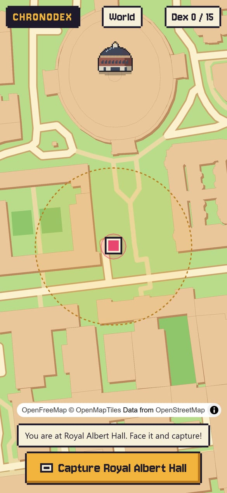
  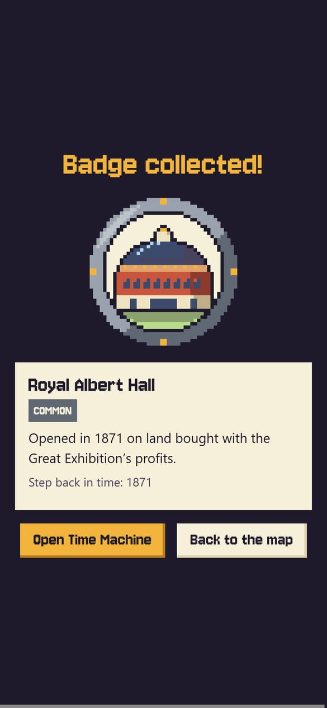
  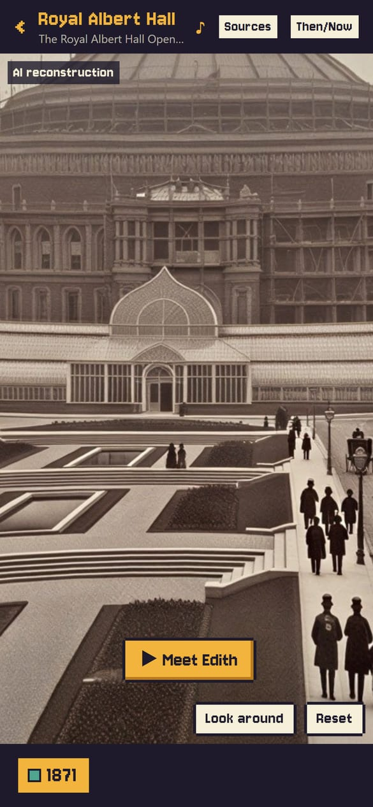
  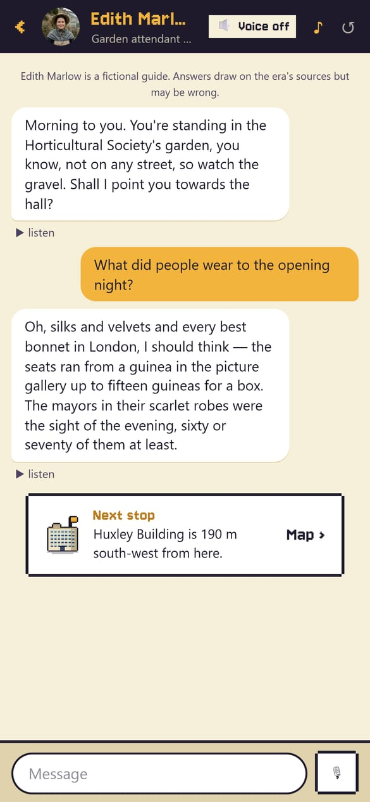
</p>

## Try it

| | |
|---|---|
| **Live app** | **<(https://maternity-jonathan-finger-explaining.trycloudflare.com)>**. Open it on a phone: camera, location and motion need one |
| **Where it works** | Six landmarks have ready eras: Queen's Tower, Royal Albert Hall and the Natural History Museum in London, plus Mexico City, Porto and Singapore. Ten more are on the map and unlock as their eras are generated |
| **Not near one?** | You can still browse the map, the globe and the Dex. Captures need you within 50 m of a landmark's photo spot |
| **Technical writeup** | [TECHNICAL_WRITEUP.md](TECHNICAL_WRITEUP.md): architecture, AI pipeline, data sources and APIs |

The live app is served from a team laptop through a Cloudflare quick tunnel, so the address changes if the tunnel
restarts. If the link is down, ask the team for the current one or run it locally (below).

## How to play

### 1. Explore the map

The home screen is a retro, handheld-RPG style map built from OpenStreetMap data. Each landmark is a pixel-art
sprite. Your position is the pink square, and the dashed circle is the 50 m capture zone. Tap a sprite for its
card: rarity, a one-line history, the years you can visit and how far you are from its photo spot. Tap
**World** to zoom out to a globe that shows every city in the game.

<p align="center">
  
  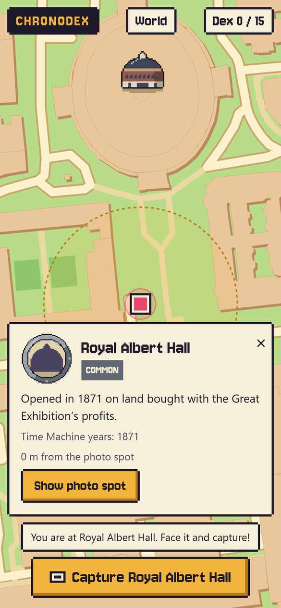
  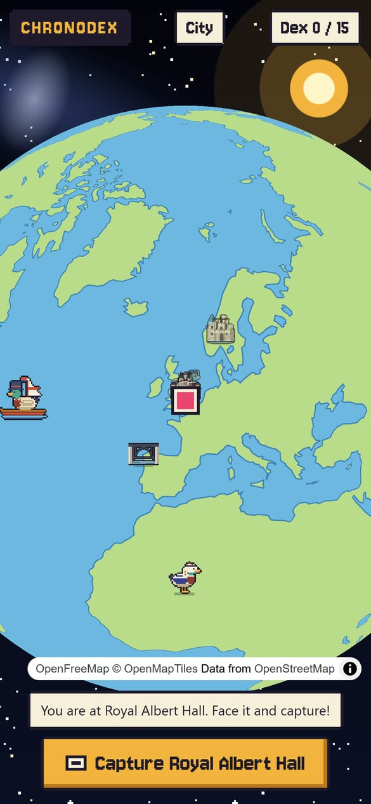
</p>

### 2. Capture a landmark

Stand at the photo spot, face the landmark and press **Capture**. The camera opens with the landmark's name in
the frame. Take the photo, then **Use this photo**. If you are close enough you collect its badge. If not, the
app tells you how far the nearest landmark is and in which direction.

<p align="center">
  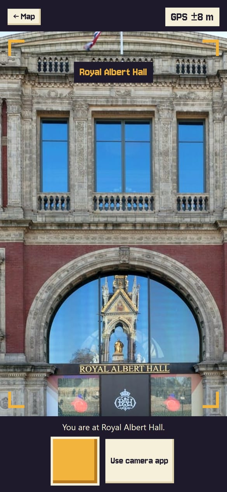
  
  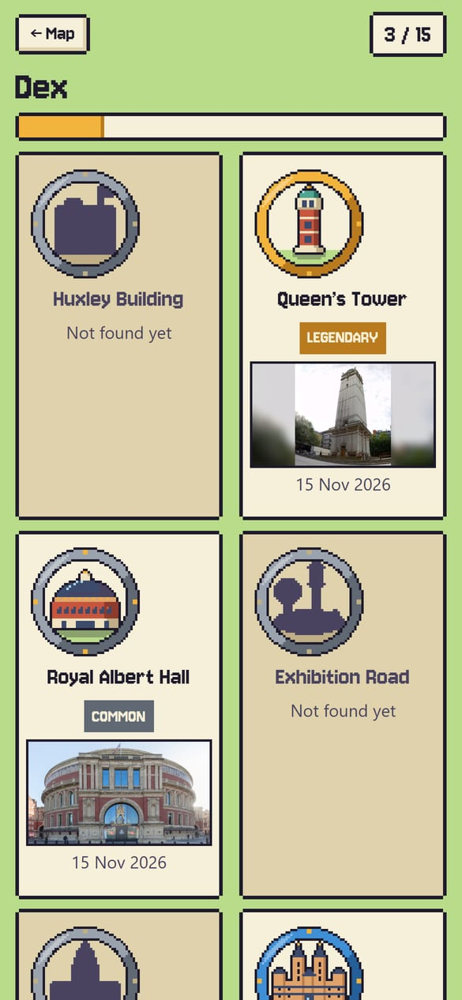
</p>

### 3. Fill your Dex

The **Dex** holds every badge. Collected ones show in colour with your photo and the date. The rest are
silhouettes marked "Not found yet". The counter at the top of the map (Dex 3 / 15) tracks your progress.

### 4. Step into the Time Machine

After a capture, **Open Time Machine**. Pick a year from the bar at the bottom.

- **Look around.** The view is a full 360° panorama of the place in that year. Move your phone to turn, or drag.
  **Reset** faces you back at the landmark.
- **Meet the guide.** Tap **Meet Edith** (each era has its own guide). They walk up, introduce themselves,
  talk for about 40 seconds about the place and the customs of the time, with captions, then walk off.
- **Sources.** The summary, fun facts and every source the history was written from, with picture credits.
- **♪** toggles period music and street sounds, chosen to suit the year.

Every generated view carries an **AI reconstruction** label.

<p align="center">
  
  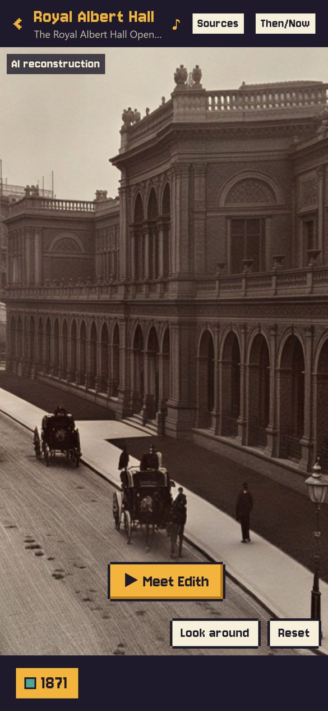
  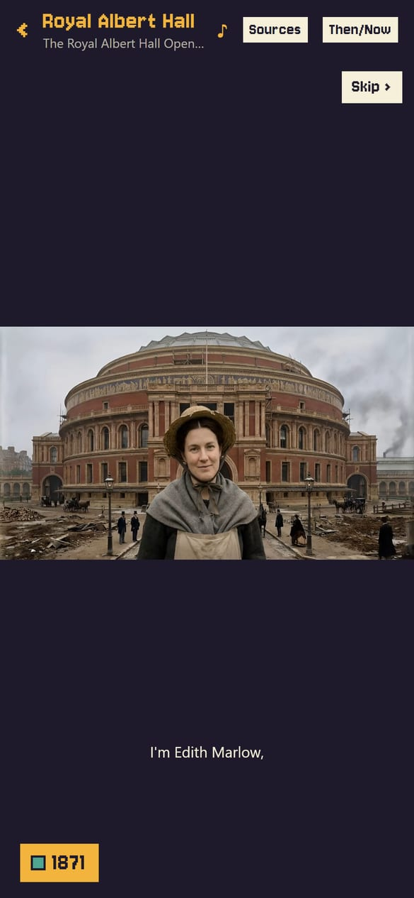
  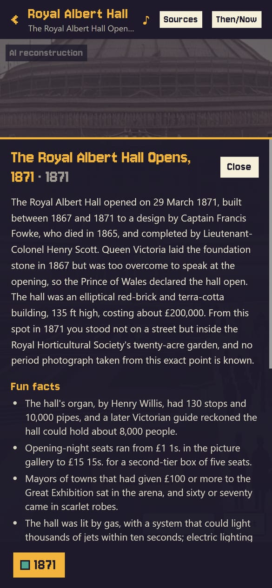
</p>

### 5. Chat with the guide

Tap **Chat with ...** to message the guide. They answer in character, briefly, from the era's sources, and say
so when they don't know. Type, or hold the microphone to talk. Tap **▶ listen** to hear a reply in the guide's
own voice, or turn **Voice** on to hear every reply. A **Next stop** card points you to the nearest landmark you
haven't collected.

<p align="center">
  
  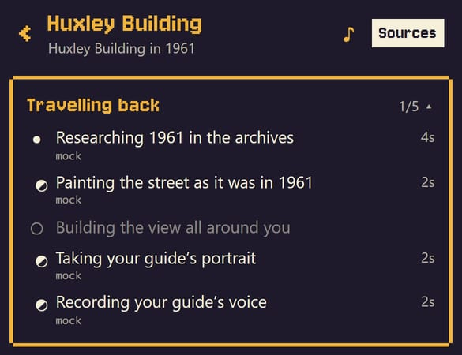
</p>

### 6. Visit a year nobody has seen yet

If you pick a year that hasn't been generated, the Time Machine generates it on the spot. A progress sheet
lists each step (research, painting the street, building the 360° view, the guide's portrait, the guide's
voice) with the AI model doing it and how long it took. Eras are shared, so once anyone has generated a year,
it loads instantly for everyone. (The progress screenshot above is from mock mode.)

## Game mechanics

| Mechanic | Rule |
|---|---|
| Capture range | Within **50 m** of the landmark's photo spot, the pavement point it is photographed from. The server decides, not the phone |
| GPS allowance | Up to **25 m** of the phone's reported GPS error is forgiven, because GPS is poor between tall buildings |
| Too far | You are told the distance and compass direction to the nearest landmark |
| Rarity | Each landmark is **common, rare, epic or legendary**, shown by its badge ring and tag |
| Dex | 15 badges. One capture per landmark per player. Your Dex is cached so it still opens offline |
| Eras | Each landmark has one or more years. Each year has one shared era: one panorama, one guide and one voice for every player |
| Grey landmarks | A landmark with no ready era is greyed out ("Time Machine coming soon"). You can still collect its badge |
| Guides | Fictional everyday people from that year (a porter, a garden attendant), never real historical figures |
| Next stop | The guide suggests the nearest landmark you haven't collected, within 20 km |
| Identity | No login. An anonymous player id lives in your browser |

## The landmarks

| City | Landmarks (years) |
|---|---|
| London | Queen's Tower (1893, 1962), Royal Albert Hall (1871), Natural History Museum (1862, 1881), Huxley Building (1885, 1961), Exhibition Road (1862, 2011), V&A (1941) |
| Mexico City | Zócalo and Metropolitan Cathedral (1519) |
| Porto | Dom Luís I Bridge (1886) |
| Lisbon | Praça do Comércio (1754 and 1775, before and after the 1755 earthquake) |
| Singapore | Raffles' Landing Site (1819), Raffles Hotel (1887), Merlion Park (1972) |
| Oslo | Viking Ship Museum (834, 1904), Akershus Fortress (1299, 1624) |
| Cambridge | Emmanuel College (1584, 1677) |
| Beijing | Great Wall at Badaling (1505) |

Eight eras are generated and ready to visit: Queen's Tower 1893 and 1962, Royal Albert Hall 1871, Natural
History Museum 1862 and 1881, Zócalo 1519, Dom Luís I Bridge 1886 and Raffles' Landing 1819.

## Built with

| | Used for |
|---|---|
| **fal** | Every generated image, sound and video: scene and 360° panorama (Nano Banana Pro), upscaling (SeedVR), guide portrait (Nano Banana 2.1), guide voice (ElevenLabs v4 and Gemini TTS), speech to text (ElevenLabs Scribe v2), period music and street sound, the talking guide (Kling AI Avatar) and walk-on and walk-off clips (Kling 4.0) |
| **Claude (Anthropic)** | Image critic. Claude Sonnet, called through fal, checks every scene and panorama for anachronisms, seams and projection errors before it is kept |
| **ElevenLabs** | Guide voices, chat replies and voice input, through fal |
| **MongoDB Atlas** | Landmarks with a geo index, eras, captures, the job queue and a GridFS store of every generated file |
| **DeepSeek** | The Historian that researches each year and writes its brief, and the in-character guide chat |
| **MapLibre GL, OpenFreeMap, OpenStreetMap** | The game-style map and globe |
| **Photo Sphere Viewer** | The 360° view with gyroscope control |
| **Wikimedia Commons** | Openly licensed reference photos and period images |
| **Next.js 16, React 19, TypeScript, Tailwind** | The app and its API |

## Run it locally

Needs Node 24 or later (`.nvmrc`) and npm.

```sh
npm install
cp .env.example .env.local   # mocks are on by default: no keys or database needed
npm run dev                  # http://localhost:3000
```

**Mock mode** (`NEXT_PUBLIC_USE_MOCKS=1`) serves every screen from `fixtures/` with no network, and generating
a year runs a fake 20-second job. Set `NEXT_PUBLIC_DEV_TOOLS=1` for a panel that fakes your location, so you can
capture from your desk.

**Real mode** needs these in `.env.local`, each documented in [.env.example](.env.example): `MONGODB_URI` and
`MONGODB_DB`, `FAL_KEY`, `DEEPSEEK_API_KEY`, and `NEXT_PUBLIC_USE_MOCKS` left empty. Then:

```sh
npm run seed       # load the 16 landmarks and their eras into MongoDB
npm run build && npm run start
npm run worker     # in a second terminal: generates eras that players request
```

**On a phone.** Camera, location and the gyroscope need HTTPS. Use `npx next dev --experimental-https` on the
same Wi-Fi, or put a tunnel in front of the server (`cloudflared tunnel --url http://localhost:3000`).

| Script | Does |
|---|---|
| `npm run dev` | Next.js dev server |
| `npm run check` | Type check, lint (every export must have a doc comment) and unit tests |
| `npm run worker` | The generation worker: claims jobs from MongoDB and runs the fal pipeline |
| `npm run seed` | Load landmarks and eras into MongoDB. `-- --dry-run` only validates |
| `npm run brief -- <eraId>` | Run the Historian for one era and save `briefs/<eraId>.md` for a human to check |
| `npx tsx scripts/pregenerate.ts` | Generate eras ahead of time with a cost cap (`--max-usd`). Guide videos: see [VIDEO_RUNBOOK.md](VIDEO_RUNBOOK.md) |

## Honest limits

- The views are **AI reconstructions**, not photographs. Each era's text is written from cited sources, and
  the app says so on every screen.
- Most reference photos are openly licensed Wikimedia Commons stand-ins, not our own. Where a generated scene
  does not keep the photo's viewpoint, the Then/Now slider is hidden.
- Only one guide video (Royal Albert Hall 1871) has been generated so far: the video tier costs about $4.34
  an era. The other eras play a free preview instead: the guide's portrait walks on over the scene while their
  real narration plays.
- The live server is one laptop. If it sleeps, the link goes down.

## How we built it

Six AI coding agents built the app in parallel, each owning its own folders and talking on a shared board
(Core, Studio, Explorer, Time Machine, Archivist, Demo set). The plan is [MASTER.md](MASTER.md), the running
log is [DEV_NOTEBOOK.md](DEV_NOTEBOOK.md) and the agents' conversation is [BOARD.md](BOARD.md).
