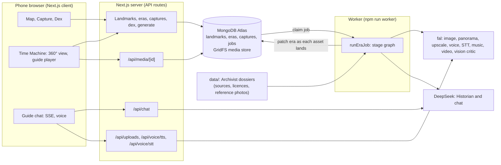

# Chronodex: technical writeup

Imperial AI Hackathon, 14 to 15 November 2026. Team: Ishan, Alex, Azlan and Fernando.
For what the app does and how to play it, see [README.md](README.md).

## 1. Summary

Chronodex turns a real landmark into a doorway to its past. A player photographs a landmark from where it stands.
The server checks they are within 50 m and awards a badge. The app then opens that place in a chosen year: a 360°
panorama, a guide from that year who speaks for about 40 seconds, and an in-character chat by text or voice.

Every piece of the past is generated, and each era is generated once and then shared by every player:

- **Facts:** an AI Historian writes them from checked, cited sources.
- **Scene and 360° view:** an image model repaints a present-day photo into the year and outpaints it to a full sphere.
- **Image checks:** a second model inspects every picture before it is kept.
- **Guide:** a portrait, a voice and a lip-synced video, all made with fal.

The hard parts were:

- keeping a multi-minute, multi-model pipeline cheap and restartable;
- making AI history defensible (sources, licences, honest labels);
- making a 360° view and camera capture work in a phone browser with no app install.

## 2. System overview



**Why a worker.** A full era takes minutes, and a guide video about 15 minutes. Serverless requests time out long
before that. So the API only enqueues a job in MongoDB. A separate Node process claims it and writes each result
to the era the moment it exists. The phone polls every 3 s and shows assets as they land. If the worker is down,
everything already generated still loads.

**One deploy.** Front end and API are one Next.js 16 app (App Router, React 19, TypeScript, Tailwind 4). For the
demo it runs as a production build on a team laptop, exposed over HTTPS through a Cloudflare quick tunnel.
Camera, geolocation and the gyroscope all need HTTPS. The app can also deploy to Vercel unchanged; only the
worker needs a long-lived machine.

## 3. Repository layout

| Path | What it is |
|---|---|
| `src/app/` | Pages: `/` map, `/capture`, `/dex`, `/time/[landmarkId]`, `/chat/[eraId]`. API routes under `src/app/api/` |
| `src/components/explore/` | Map (MapLibre), capture, Dex, globe ducks, location and image-resize helpers |
| `src/components/time-machine/` | 360° viewer, guide player, captions, ambience, Then/Now slider, sources drawer, progress sheet |
| `src/components/chat/` | Chat screen, composer, hold-to-talk recorder, history, next-stop card |
| `src/components/ui/` | Shared pixel-style kit: button, card, sheet, toast, spinner, progress list |
| `src/lib/contracts/` | The shared types, zod schemas and pure helpers (geo, ids, capture rule). Frozen early so agents could build in parallel |
| `src/lib/client/` | Typed browser API client, SSE parser and a full mock mode served from `fixtures/` |
| `src/lib/db/`, `src/lib/jobs/` | MongoDB access (with an in-memory fallback), job queue and the generation rules |
| `src/lib/historian/` | Writes an era's brief: research, then structured writing, then validation |
| `src/lib/chat/` | Persona chat and a small fetch-based DeepSeek streaming client |
| `src/lib/fal/` | The single fal wrapper `runFal`, the model registry `models.ts`, the voice catalogue, TTS and STT |
| `src/lib/pipeline/` | `runEraJob` and one file per stage, including the image critic |
| `src/lib/media/` | Content-addressed store for every generated file (GridFS or a folder) |
| `src/lib/archive/` | Reads the Archivist's `data/` dossiers into the seed and the Historian |
| `src/worker/` | Claim loop, lease heartbeat, clean shutdown |
| `data/` | Landmark geometry, research notes, reference photos and attribution, each with a source |
| `scripts/` | Seed, Historian runs, pre-generation with a cost cap, media backup, demo-set loader |

## 4. Front end

**Map.** MapLibre GL renders OpenFreeMap vector tiles (OpenStreetMap data) through our own 19-layer style
(`src/components/explore/lib/game-map-style.ts`):

- flat retro "handheld RPG" colours, no labels, buildings with drop shadows;
- pixel-art sprites for landmarks, with a dashed circle for the capture zone;
- **World** switches MapLibre to its globe projection, with three costumed pixel ducks travelling fixed routes;
- landmarks with no ready era are greyed out, so a player never opens an empty Time Machine.

**Capture.** `getUserMedia` opens the rear camera, with a file-input fallback for browsers that refuse. The
photo is resized in the browser to at most 1600 px JPEG under 4 MB, then uploaded. The server then decides the
capture (section 6).

**Time Machine.**

- **360° view.** Photo Sphere Viewer 5 with its gyroscope plugin. We damp the gyroscope with a 0.25° dead zone
  and smoothing, because raw phone motion jitters. iOS requires a tap before it grants motion access.
- **Guide player.** Plays the three clips (walk on, talk, walk off) through two stacked `<video>` elements, so
  there is no black frame between clips. Until a video exists, a free preview stands in: the guide's portrait
  walks on over the scene while the real narration plays. Captions are timed from the script.
- **Ambience.** Two Web Audio layers, period music and street sound, chosen by date bucket (1850 to 1899,
  1900 to 1945, 1946 to 1979, 1980 on). They duck under speech and fall silent while the microphone records.
- **Live progress.** A progress sheet lists each pipeline stage with its model and time while a year generates.
- **Caching.** Generated media is kept in Cache Storage, and the last era response in `localStorage`, so a
  revisit opens at once.

**Chat.**

- Replies stream over Server-Sent Events, parsed by a small hand-written client because `EventSource` cannot POST.
- **▶ listen** speaks a reply in the guide's voice.
- Hold-to-talk records with `MediaRecorder`. Recordings under 400 ms are discarded.
- History is kept per era in `localStorage`.
- A next-stop card points to the nearest uncollected landmark.

**Mock mode.** `NEXT_PUBLIC_USE_MOCKS=1` makes the typed client answer from fixtures, with a fake job that
advances through its stages. It let the front-end agents build every screen before the back end existed.

## 5. API

All bodies are JSON and validated with zod. Errors are `{ error: { code, message } }`.

| Route | Purpose |
|---|---|
| `GET /api/landmarks` | All landmarks |
| `GET /api/landmarks/[id]/eras` | One era per year of a landmark |
| `GET /api/eras/[eraId]` | The era and its active job, polled while generating |
| `POST /api/eras/[eraId]/generate` | Enqueue the missing tiers. Idempotent: returns the active job if one exists |
| `POST /api/captures` | Decide a capture on the server (section 6) |
| `GET /api/players/[playerId]/dex` | A player's captures |
| `POST /api/chat` | Streamed in-character reply (SSE) |
| `POST /api/uploads` | Store a capture photo (JPEG only, magic bytes checked, under 4 MB) |
| `POST /api/voice/tts` | Speak a reply in the era's guide voice (the server picks the voice) |
| `POST /api/voice/stt` | Transcribe a voice message |
| `GET /api/media/[id]` | Serve a stored file: immutable caching, ETag, and HTTP Range (iOS needs it for audio and video) |
| `GET /api/media/credits/[eraId]` | Picture credits for the Sources drawer |

## 6. Data model and game rules

The contracts live in `src/lib/contracts/types.ts`.

- **Landmark:** `photoSpot`, `subject`, rarity, sprite, badge, a 16:9 reference photo and `eraYears`.
- **Era** (`<landmarkId>_<year>`): the Historian's text (title, summary, fun facts, sources, a scene brief with
  a change list) and the guide (name, role, appearance, voice, script, greeting). It also holds media URLs: scene,
  panorama, headshot, narration, guide video.
- **Two states per era:** a core tier and a video tier, because the video costs about eight times the rest.
- **Job:** an ordered list of stages, each with its model, timings, error and the fal request id.

**MongoDB collections and indexes.**

- `landmarks`: a 2dsphere index on a GeoJSON copy of the photo spot, for "nearest landmark".
- `eras`: unique on landmark and year.
- `captures`: unique on player and landmark.
- `jobs`: a unique partial index on `eraId` where `active` is true. This guarantees one running job per era, so
  two players who request the same year never pay twice. The worker claims jobs atomically with
  `findOneAndUpdate`, under a 10-minute lease renewed while fal is working. A crashed worker's job can be
  reclaimed.
- `media_assets`: the ledger for the GridFS media store.

**The capture rule** is one pure function, unit tested and shared by client and server:

```
accepted = max(0, distanceM - min(accuracyM, 25)) <= 50
```

- `distanceM` is the haversine distance to the **photo spot**, the pavement point the landmark is photographed
  from. Measuring to the building centre would put large buildings out of reach from any street.
- Up to 25 m of the phone's reported GPS error is forgiven.
- The server decides. The client uses the same function only to show distance and enable the button.
- A failed capture returns the nearest landmark's distance and direction.

## 7. The generation pipeline

`runEraJob` (`src/lib/pipeline/run.ts`) runs a dependency graph. Independent stages run in parallel, and each
output is written to the era the moment it exists:

```
brief (Historian)
 ├─ scene ──► panorama          core tier: the player can look around
 ├─ headshot                    chat profile picture
 └─ narration                   guide speech, plays over the panorama
      video tier (needs scene, headshot, narration):
      guide_frame ──► walk_on ┐
                  ──► talk    ├─► stitch (optional)
                  ──► walk_off┘
```

### 7.1 Models (all through fal unless noted)

| Stage | Model | Notes |
|---|---|---|
| brief | DeepSeek `deepseek-flash` (direct API) | Section 8 |
| scene | `fal-ai/nano-banana-pro/edit` | Edits the present-day reference photo into the year from a change list: persists, altered, not yet built, gone |
| panorama | `fal-ai/nano-banana-pro/edit` at 2K | The scene is pasted into a grey 2:1 equirectangular canvas and outpainted to a full sphere. Up to 3 period reference images |
| panorama upscale | `fal-ai/seedvr/upscale/image` | 2880×1440 to 4032×2016. A failed upscale is not fatal |
| image critic | `openrouter/router/vision` running `anthropic/claude-sonnet-5` | Checks scene, panorama and guide frame (7.3) |
| headshot | `google/nano-banana-2.1` | Square portrait from the guide's written appearance |
| narration | `elevenlabs/tts/eleven-v4` or `google/gemini-3.8-flash-tts` | Voice picked from a catalogue: two ElevenLabs London voices, three Gemini voices with Cockney style instructions, and accent-tagged voices for Mexico City, Porto and Singapore |
| chat replies | `elevenlabs/tts/eleven-v4-turbo` | Same voice names as narration, so the guide sounds the same. Identical replies are cached |
| speech to text | `fal-ai/elevenlabs/speech-to-text/scribe-v2` | Uploads are renamed by sniffed bytes, because iOS and Android record different containers |
| ambience | `sonilo/v1.1/text-to-music`, `elevenlabs/sound-effects/v3` | Period music and street-sound loops per date bucket, made once |
| guide_frame | `fal-ai/nano-banana-pro/edit` | The guide placed in the scene |
| talk | `fal-ai/kling-video/ai-avatar/v2/standard` | Lip-synced talking guide from frame and narration. Fallback `veed/fabric-1.0` |
| walk_on, walk_off | `kling/v4/image-to-video` at 720p | First and last frame given, so the guide walks into and out of the empty scene |
| stitch | `fal-ai/ffmpeg-api/merge-videos` | Optional. The player already plays the clips back to back with no gap |

Endpoint ids live only in `src/lib/fal/models.ts`, each stage with a primary and a fallback. No endpoint string
appears anywhere else in the code.

### 7.2 Never paying twice

fal is pay per call, and a hackathon budget is small. So the pipeline treats every generated file as money:

1. **One wrapper.** Every fal call goes through `runFal`, which submits to fal's queue, not `fal.subscribe`.
   The request id is saved on the job stage as soon as fal accepts it. A restarted worker re-polls that request
   instead of submitting a new one.
2. **Skip what exists.** A stage whose output is already on the era is skipped.
3. **One job per era.** Enforced by the partial unique index above.
4. **Keep our own copy.** fal's CDN keeps files about 7 days. Every output is copied into our content-addressed
   media store (MongoDB GridFS, id = SHA-256 prefix) and served from `/api/media/<id>` with immutable caching.
   When a later stage needs a stored file as input, `toFalUrl` re-uploads it to fal storage for free. It reuses
   the fal copy while it has more than a day left.
5. **Retry cap.** An era that has failed twice answers `retry_limit` instead of spending again.
6. **Video is opt-in twice over.** The video tier runs only when `VIDEO_GENERATION=on` *and* the era is on the
   `VIDEO_ERAS` allow list, so opening the app can never trigger a $4 video. Pre-generation scripts refuse to run
   above a `--max-usd` estimate, and begin with a free fal preflight call.
7. **Rate limits.** Fixed one-minute windows per client address on chat (60), generate (20), captures (60),
   uploads (20), TTS (30) and STT (20), because a public URL means open endpoints that spend credits.

### 7.3 Checking the pictures

Image models fail in recognisable ways: an outpainted panorama with grey left unpainted, a "360°" that is really a
flat wide photo, a seam, a modern car in 1871. Each checked stage runs `generateChecked`:

1. **Free checks first.** The panorama must be 2:1 within 5% and at least 30 KB. Grey unpainted area must be
   under 3%, measured locally with sharp.
2. **Then the critic.** Claude Sonnet, called through fal's OpenRouter endpoint at about $0.0125 a check, judges
   the image against the brief. A panorama is judged on projection, seams, horizon and anachronisms. A scene is
   also checked for keeping the reference photo's viewpoint.
3. **One corrective retry.** On a hard failure the critic's one-line fix is added to the prompt and the stage runs
   again. The better of the two is kept. A picture kept with problems is flagged on its job stage.

We calibrated the critic on hand-labelled panoramas:

- Sonnet agreed with a human on 6 of 8 at first, against 4 of 8 for Haiku.
- Rewording the prompt to describe what a real equirectangular curve looks like took both models to 10 of 10 on
  a labelled set of ten.
- Sonnet stays the default, because Haiku over-reported seams.
- If the critic itself fails, the image counts as a pass, so a check can never block generation.

### 7.4 Measured cost and time

| Item | Cost | Time |
|---|---|---|
| Panorama, passing first time, with upscale and check | about $0.19 | about 70 s |
| Scene with check | about $0.16 | |
| Core tier for one era (brief, scene, panorama, headshot, narration) | about $0.50 to $0.62 | a few minutes |
| Video tier for one era (guide frame, two 5 s walks, about 40 s talk) | about $4.34 | about 15 min, mostly the talk clip |
| Historian brief from Archivist notes | DeepSeek, cents | 7 to 9 s |
| Historian brief with live web search | DeepSeek, cents | 2 to 5 min |
| Chat reply | DeepSeek, fractions of a cent | about 1.5 s |

The eight demo eras' core tier was generated once and committed to the repo under `public/demo/`, so the demo
does not depend on fal's CDN or on credit.

## 8. Text: the Historian and the guide

**Historian** (`src/lib/historian/`). It writes one era's brief in two calls to DeepSeek `deepseek-flash`:

1. **Research.** Free-text notes, using DeepSeek's server-side `web_search` and `read_url` tools. The model
   sometimes answers from memory without searching, so research is retried up to 3 times until it returns
   real source URLs.
2. **Writing.** JSON mode, no tools. The result is validated with zod.

Validation and rules:

- Any source URL the research never found is dropped.
- A failed check gets one corrective retry.
- Every claim in the summary and fun facts must have a source.
- The guide is a fictional everyday person tied to the place.
- The script is about 105 to 120 words and opens with the guide's name.
- The script may not use hindsight. A guide in 1893 must not say what "never" got built.

When the Archivist has a dossier for the era (section 9), the Historian skips web search and writes from those
verified notes. That is faster (7 to 9 s instead of minutes) and never invents a source.

**Chat** (`src/lib/chat/`). DeepSeek `deepseek-flash` with thinking off, streamed. The system prompt has:

- the era's brief and the guide's persona;
- rules: stay in character, keep replies text-message short, use facts from the brief first, say so in character
  when unsure, never claim to be a real person;
- the nearest uncollected landmark within 20 km, as a possible suggestion.

All 8 demo guides were checked with real calls: in character, 45 to 72 words, facts from their briefs.

**Model history.** The plan used Claude for the Historian and chat. The team moved both to DeepSeek on the first
evening (decisions D-024 to D-026 in [DEV_NOTEBOOK.md](DEV_NOTEBOOK.md)). Claude remains in the pipeline as the
image critic, called through fal.

## 9. Information sources and licensing

Judges will ask how we know it looked like that. Our answer is a dedicated data agent, the **Archivist**, and a
rule that every claim and image has a receipt.

| Data | Source |
|---|---|
| Landmark geometry (subject, photo spot, facing) | OpenStreetMap, checked per landmark, stored with the evidence in `data/landmarks/<id>.json` |
| Present-day reference photos | Wikimedia Commons, openly licensed (for example Diego Delso, CC BY-SA 4.0 for the Royal Albert Hall), cropped to 16:9 in `data/reference/` |
| Research notes per era | Survey of London (British History Online), Imperial College history pages, Project Gutenberg (period Punch), the Victorian Web, the Royal Albert Hall archive catalogue, The Guardian archive and others. Stored as `data/eras/<eraId>.notes.txt`, one fact per line with its URL |
| Period images given to the panorama model | Wikimedia Commons and museum open-access collections (for example a Rijksmuseum CC0 image), with licence, author and page URL |
| Attribution | Generated into `data/ATTRIBUTION.md` and shown in each era's Sources drawer |

**Licence rule.** Public domain, CC0, CC BY and CC BY-SA only. Non-commercial, no-derivatives and unknown
licences are rejected. Sites such as Historic England and Getty may be cited but their images are never used.

**No Google imagery.** Google's Street View policy forbids exporting, bulk downloading or creating content
from its imagery. Feeding a Street View frame to an image model would do exactly that. So we never do it, and
the code enforces it: the Historian validator and the scene stage both reject Google image hosts.

**Honesty in the product.**

- Every generated view carries an **AI reconstruction** label.
- Every era lists its sources and picture credits.
- Thin records are stated in the summary, for example "no period photograph taken from this exact point is known".
- The chat shows "a fictional guide; answers may be wrong".
- The Then/Now slider is hidden for eras whose generated scene does not keep the reference photo's viewpoint,
  rather than showing a misleading comparison.

## 10. External APIs and services

| Service | How we call it | Auth |
|---|---|---|
| fal | `@fal-ai/client` queue API from the server and worker only. No browser proxy, so the key cannot be spent by others | `FAL_KEY` (server) |
| DeepSeek | `POST https://api.deepseek.com/chat/completions`, OpenAI-style SSE, from the server only | `DEEPSEEK_API_KEY` |
| MongoDB Atlas | Official `mongodb` driver 7, GridFS for media | `MONGODB_URI` |
| OpenFreeMap | Vector tiles and style, keyless, with attribution | none |
| Wikimedia Commons | MediaWiki API, used offline by the Archivist's scripts, polite user agent and one request a second | none |
| Cloudflare | Quick tunnel for HTTPS to the demo laptop | none |

Every variable is documented in [.env.example](.env.example).

## 11. Quality and how it was built

**Six agents, one plan.** The app was built by six AI coding agents working in parallel, each with a human:

| Agent | Role |
|---|---|
| Core | Contracts, database, API, Historian, chat |
| Studio | fal pipeline and worker |
| Explorer | Map, capture, Dex |
| Time Machine | 360° view, guide player, chat UI, media store |
| Archivist | Sources and licences |
| Demo set | Generated and checked the demo eras |

Conflicts were avoided by design:

- Every path has exactly one owner.
- The shared types were frozen in the first hour, and mock mode let every screen be built before the back end.
- Agents talked on an append-only board ([BOARD.md](BOARD.md)), one post per commit, naming whom it affects.
- Decisions, verified facts and traps went into [DEV_NOTEBOOK.md](DEV_NOTEBOOK.md), so a fresh session could pick
  up from it alone.

**Checks.** `npm run check` runs `tsc`, ESLint and Vitest: 52 test files, including:

- geo helpers, the capture rule, id helpers and zod schemas;
- prompt builders, the job queue and the pipeline on dry-run stages;
- the media store and Range requests.

The linter fails any export without a doc comment. Phone checks ran on an iPhone through the tunnel. Headless
Chrome with a fake camera and spoofed GPS covered the capture flow end to end.

## 12. Limitations and next steps

- **Reference photos.** Most are Commons stand-ins, not taken by us at the exact photo spot. Our own photos from
  the spot would let scenes keep the framing, and bring back Then/Now.
- **Guide videos.** One generated era has a full guide video. The others play the narrated portrait preview
  until credit allows the $4.34 video tier.
- **Hosting.** One laptop and a quick tunnel. Production would put the app on Vercel and the worker on a small
  VM, both already supported.
- **Next.** A walkable world from the era's scene using fal's real-time world model, and the past overlaid on the
  live camera. Also: a compass-aligned panorama (`centreBearingDeg` is already stored), and more cities, which
  only need data files and sprites.
