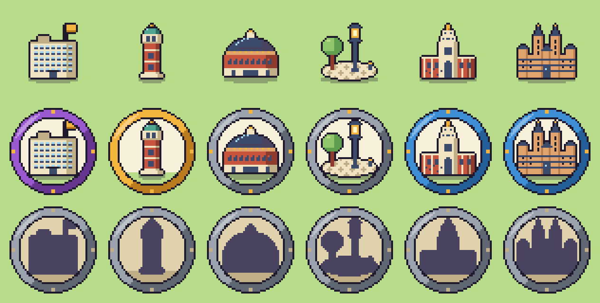

# Chronodex art direction

Owner: Agent 3. Task A3-01 in `MASTER.md` section 11. Assumption A1: an original retro handheld-RPG look, with no names, sprites, fonts, sounds or map layouts from any existing game.

## The idea

"Albertopolis on a handheld." The colours of South Kensington itself (terracotta, red brick, Portland stone, copper verdigris, slate roofs, park green), pushed to flat, saturated game tones. Each landmark is a small, front-on portrait of the real building, so a player can match the sprite to what is in front of them.

## Rules

1. **Flat colour and hard edges.** No gradients, no anti-aliasing. Light comes from the upper left, so the right-hand side of a shape is one shade darker.
2. **One-pixel ink outline** (`ink`, `#1e1a2b`) round every sprite, so it reads on any map colour.
3. **Whole-number scaling only.** Sprites are drawn at 32 × 32 and exported at 4×. On screen they are shown at 64 CSS px (2×) with `image-rendering: pixelated`. Never at 1.5× or 3.3×: the pixels go uneven.
4. **Palette only.** Every colour comes from `src/lib/palette.ts`. fal output is snapped to it (`scripts/pixel/pixelate.ts`).
5. **Rarity is the badge rim.** Grey common, blue rare, purple epic, gold legendary.
6. **Pixel font for game text only.** Jersey 10 (SIL Open Font Licence) for titles, buttons and chips. The system font for sentences. Pixelify Sans was tried and dropped: its bold "C" reads as "O" on a phone.

## Palette

| Token | Hex | Used for |
|---|---|---|
| `ink` | `#1e1a2b` | Outlines, text |
| `inkSoft` | `#4a4360` | Secondary text, silhouettes |
| `paper` / `paperShade` | `#f6efd9` / `#dfd2ac` | Cards, sheets, badge fields |
| `ground` | `#b9dc8a` | Map ground |
| `park` / `wood` | `#8fc66b` / `#5f9e4e` | Lawns, trees |
| `water` / `waterDeep` | `#6cb8e0` / `#3d82b8` | Water |
| `road` / `roadEdge` / `path` | `#fbf1cf` / `#c9a66b` / `#ead9a4` | Streets, footpaths |
| `building` / `buildingShade` | `#e9c79a` / `#b98a5e` | Map buildings and their drop shadow |
| `brick` / `brickDark` | `#c8553d` / `#8e3a2d` | Albert Hall, Queen's Tower, V&A |
| `terracotta` | `#e0a36b` | Natural History Museum |
| `stone` / `stoneDark` | `#efe3c2` / `#bfae86` | Portland stone, concrete |
| `verdigris` / `verdigrisDark` | `#4fa58f` / `#2f6f62` | Copper domes |
| `slate` | `#3c4a6b` | Roofs, windows, doors |
| `glass` | `#a9d8ef` | Highlights |
| `gold` / `goldDark` | `#f2b43c` / `#b97b1e` | Finials, capture button, legendary |
| `player` | `#e8466e` | The player marker and accuracy ring |

## Files

| File | Size | Use |
|---|---|---|
| `sprites/<landmarkId>.png` | 128 × 128 | Map marker (`Landmark.spriteUrl`) |
| `sprites/badges/<landmarkId>.png` | 192 × 192 | Collected Dex badge (`Landmark.badgeUrl`) |
| `sprites/badges/<landmarkId>-locked.png` | 192 × 192 | Not-yet-collected silhouette for the Dex |
| `preview/contact-sheet.png` | | Review sheet. Not used by the app |
| `fal/<landmarkId>.png` | 128 × 128 | fal candidates, only after `npm run art:fal`. Not used unless adopted |

`art/sprites/` mirrors the app's `public/sprites/`, so the URLs are the same in both. Regenerate everything with `npm run art` (free, under a second). Add `-- --publish` to copy the result into `public/sprites/`.
